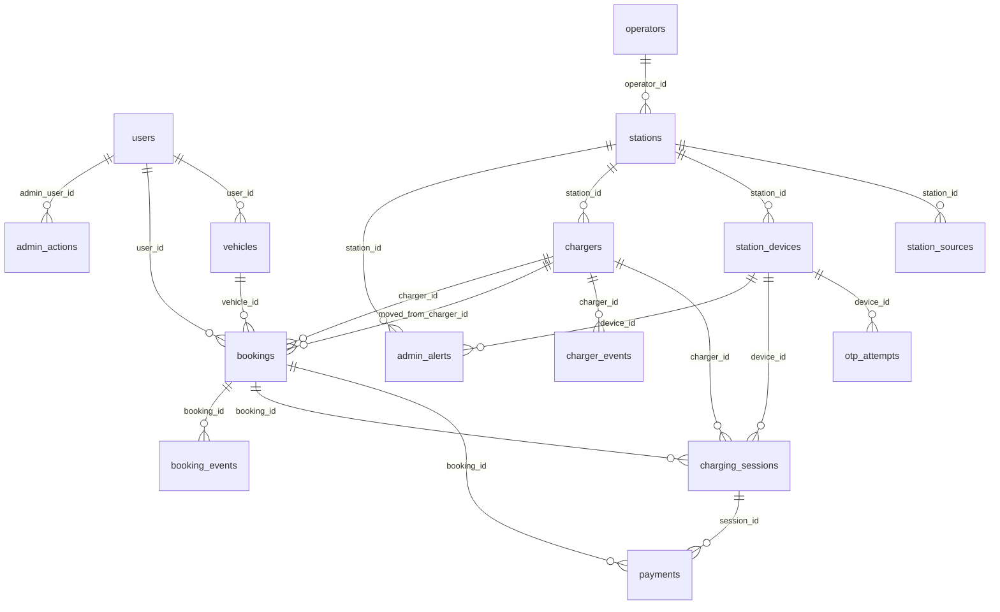

# Database schema

PostgreSQL (Supabase in production, plain PostgreSQL for tests). This file was generated from a database with **all 16 migrations applied** (`database/migrations/001` to `016`). The migration files are the source of truth: never edit an applied one, add a new numbered file. Every table has row-level security switched on with no policies, so Supabase's public REST API can read and write nothing; only the API (connecting as the table owner) can.

## Overview

| Table | Migration | Purpose | SQLAlchemy model |
|---|---|---|---|
| `admin_actions` | 016 | What admins changed and who did it: roles, kiosk keys, out of service, edits (the admin activity log). | none (raw SQL only) |
| `admin_alerts` | 014 | Flags the system raises for the admin page: kiosk code guessing and failed payment webhooks (kind check extended in 015). An alert that repeats within 10 minutes is shown once. | none (raw SQL only) |
| `allowed_booking_transitions` | 004 | The legal status moves, as data. The trigger reads it; `state_machine.py` has an identical copy (a test compares them). | none (raw SQL only) |
| `booking_events` | 004 | History of every status change, written by the trigger (who, why, when). Also a row when a booking is moved to another charger. | none (raw SQL only) |
| `bookings` | 004 | Every way a charger gets used (app, instant, walk-in). The exclusion constraint forbids two live bookings overlapping on one charger; a trigger allows only legal status changes. | `backend/app/features/bookings/models.py` |
| `charger_events` | 006 | Log of every charger event (reserve, release, session start/stop, outside start, fault, rejected starts). | none (raw SQL only) |
| `chargers` | 003 | One row = one bookable plug. `status` is the live physical state and changes only through charger events. | `backend/app/features/stations/models.py` |
| `charging_sessions` | 006 | One row per time a charger delivers energy: for a booking, a walk-in, or an outside (EXTERNAL) driver. Holds the bill. | `backend/app/features/charging/models.py` |
| `geocode_cache` | 008 | Remembered Nominatim answers (30 days) so a place is looked up once. | none (raw SQL only) |
| `job_rules` | 011 | Numbers the SQL jobs read (lock minutes, no-show minutes, efficiency...). A test checks they equal `backend/app/config.py`. | none (raw SQL only) |
| `operators` | 003 | Companies that run stations (Tata Power, Jio-bp...). Spelling variants are merged on import, so the name is unique. | `backend/app/features/stations/models.py` |
| `otp_attempts` | 005 | Every code typed at a kiosk, right or wrong: 5 wrong in a row means a 2-minute wait, 20 wrong in 10 minutes raises an admin alert. | none (raw SQL only) |
| `payments` | 007 | Razorpay payments: the booking fee, the energy bill (`ENERGY`) and a walk-in's prepayment (`WALKIN_PREPAID`, a payment link). Refunds are recorded here, not sent. | `backend/app/features/payments/models.py` |
| `schema_migrations` | (runner) | Which migration files have been applied. Created by `database/migrate.py`, not by a migration. | none (raw SQL only) |
| `station_devices` | 005 | One kiosk tablet per station, signing in with an API key stored as a hash (the key is shown once, when it is created). The `X-Device-Key` header is checked against it; a device acts only on its own station. | none (raw SQL only) |
| `station_sources` | 003 | Every outside record (OSM, OCM, manual) a station was built from, so re-running an import updates instead of duplicating. | none (raw SQL only) |
| `stations` | 003 | Charging stations. The app shows only `FOUR_WHEELER` stations; two-wheeler ones are kept hidden. `estimated_fields` lists generated values. | `backend/app/features/stations/models.py` |
| `users` | 002 | Accounts from Google sign-in or email registration. Columns and ids match the old database so existing logins keep working. | `backend/app/features/auth/models.py` |
| `vehicles` | 002 | A user's cars. The plug decides which chargers fit; the battery size caps charging energy. At most one default per user. | `backend/app/features/vehicles/models.py` |
| `webhook_events` | 007 | Each Razorpay webhook event id, so an event is processed once. | `backend/app/features/payments/models.py` |

Tables without a model are read or written with plain SQL or by the database itself (triggers and functions). SQLAlchemy models mirror the schema and **never create tables**.

## Relationships

## Custom types (domains)

- **`connector_type`**: `text`, CHECK ((VALUE = ANY (ARRAY['CCS2'::text, 'TYPE2'::text, 'CHADEMO'::text, 'BHARAT_AC001'::text, 'BHARAT_DC001'::text, 'TYPE1'::text, 'OTHER'::text])))
- **`data_source`**: `text`, CHECK ((VALUE = ANY (ARRAY['ocm'::text, 'osm'::text, 'synthetic'::text, 'manual'::text])))
- **`money_inr`**: `numeric(10,2)`, CHECK ((VALUE >= (0)::numeric))

The allowed values are mirrored in `frontend/shared/src/constants.ts` (`CONNECTOR_TYPES`, `DATA_SOURCES`, statuses) and in the API's `ConnectorType` literal; change all of them together.

## Tables

### `admin_actions`

What admins changed and who did it: roles, kiosk keys, out of service, edits (the admin activity log). (migration 016; row-level security: on)

| Column | Type | Null? | Default |
|---|---|---|---|
| `action_id` | `bigint` | no | `(identity)` |
| `admin_user_id` | `uuid` | yes |  |
| `admin_email` | `text` | no |  |
| `action` | `text` | no |  |
| `target` | `text` | yes |  |
| `details` | `jsonb` | no | `'{}'::jsonb` |
| `created_at` | `timestamp with time zone` | no | `now()` |

**Constraints**

- Foreign key `admin_actions_admin_user_id_fkey`: `FOREIGN KEY (admin_user_id) REFERENCES users(user_id) ON DELETE SET NULL`
- n `admin_actions_action_id_not_null`: `NOT NULL action_id`
- n `admin_actions_action_not_null`: `NOT NULL action`
- n `admin_actions_admin_email_not_null`: `NOT NULL admin_email`
- n `admin_actions_created_at_not_null`: `NOT NULL created_at`
- n `admin_actions_details_not_null`: `NOT NULL details`
- Primary key `admin_actions_pkey`: `PRIMARY KEY (action_id)`

**Indexes**

- `admin_actions_time`: `btree (created_at DESC)`

### `admin_alerts`

Flags the system raises for the admin page: kiosk code guessing and failed payment webhooks (kind check extended in 015). An alert that repeats within 10 minutes is shown once. (migration 014; row-level security: on)

| Column | Type | Null? | Default |
|---|---|---|---|
| `alert_id` | `uuid` | no | `gen_random_uuid()` |
| `kind` | `text` | no |  |
| `station_id` | `uuid` | yes |  |
| `device_id` | `uuid` | yes |  |
| `message` | `text` | no |  |
| `details` | `jsonb` | no | `'{}'::jsonb` |
| `created_at` | `timestamp with time zone` | no | `now()` |
| `resolved_at` | `timestamp with time zone` | yes |  |

**Constraints**

- Check `admin_alerts_kind_check`: `CHECK ((kind = ANY (ARRAY['KIOSK_OTP_GUESSING'::text, 'WEBHOOK_FAILED'::text])))`
- Foreign key `admin_alerts_device_id_fkey`: `FOREIGN KEY (device_id) REFERENCES station_devices(device_id) ON DELETE SET NULL`
- Foreign key `admin_alerts_station_id_fkey`: `FOREIGN KEY (station_id) REFERENCES stations(station_id) ON DELETE CASCADE`
- n `admin_alerts_alert_id_not_null`: `NOT NULL alert_id`
- n `admin_alerts_created_at_not_null`: `NOT NULL created_at`
- n `admin_alerts_details_not_null`: `NOT NULL details`
- n `admin_alerts_kind_not_null`: `NOT NULL kind`
- n `admin_alerts_message_not_null`: `NOT NULL message`
- Primary key `admin_alerts_pkey`: `PRIMARY KEY (alert_id)`

**Indexes**

- `admin_alerts_device`: `btree (device_id, kind, created_at DESC)`
- `admin_alerts_open`: `btree (created_at DESC) WHERE (resolved_at IS NULL)`

### `allowed_booking_transitions`

The legal status moves, as data. The trigger reads it; `state_machine.py` has an identical copy (a test compares them). (migration 004; row-level security: on)

| Column | Type | Null? | Default |
|---|---|---|---|
| `from_status` | `text` | yes |  |
| `to_status` | `text` | no |  |
| `source` | `text` | yes |  |
| `description` | `text` | no |  |

**Constraints**

- Check `allowed_booking_transitions_source_check`: `CHECK ((source = ANY (ARRAY['APP'::text, 'INSTANT'::text, 'WALK_IN'::text])))`
- n `allowed_booking_transitions_description_not_null`: `NOT NULL description`
- n `allowed_booking_transitions_to_status_not_null`: `NOT NULL to_status`

**Indexes**

- `allowed_booking_transitions_unique`: `btree (COALESCE(from_status, '*'::text), to_status, COALESCE(source, '*'::text))`

### `booking_events`

History of every status change, written by the trigger (who, why, when). Also a row when a booking is moved to another charger. (migration 004; row-level security: on)

| Column | Type | Null? | Default |
|---|---|---|---|
| `event_id` | `bigint` | no | `(identity)` |
| `booking_id` | `uuid` | no |  |
| `from_status` | `text` | yes |  |
| `to_status` | `text` | no |  |
| `actor` | `text` | no |  |
| `reason` | `text` | yes |  |
| `created_at` | `timestamp with time zone` | no | `now()` |

**Constraints**

- Check `booking_events_actor_check`: `CHECK ((actor = ANY (ARRAY['USER'::text, 'DEVICE'::text, 'SYSTEM'::text, 'ADMIN'::text])))`
- Foreign key `booking_events_booking_id_fkey`: `FOREIGN KEY (booking_id) REFERENCES bookings(booking_id) ON DELETE CASCADE`
- n `booking_events_actor_not_null`: `NOT NULL actor`
- n `booking_events_booking_id_not_null`: `NOT NULL booking_id`
- n `booking_events_created_at_not_null`: `NOT NULL created_at`
- n `booking_events_event_id_not_null`: `NOT NULL event_id`
- n `booking_events_to_status_not_null`: `NOT NULL to_status`
- Primary key `booking_events_pkey`: `PRIMARY KEY (event_id)`

**Indexes**

- `booking_events_booking`: `btree (booking_id, created_at)`

### `bookings`

Every way a charger gets used (app, instant, walk-in). The exclusion constraint forbids two live bookings overlapping on one charger; a trigger allows only legal status changes. (migration 004; row-level security: on)

| Column | Type | Null? | Default |
|---|---|---|---|
| `booking_id` | `uuid` | no | `gen_random_uuid()` |
| `user_id` | `uuid` | yes |  |
| `charger_id` | `uuid` | no |  |
| `vehicle_id` | `uuid` | yes |  |
| `source` | `text` | no |  |
| `status` | `text` | no |  |
| `time_range` | `tstzrange` | no |  |
| `hold_expires_at` | `timestamp with time zone` | yes |  |
| `otp_hash` | `text` | yes |  |
| `otp_used_at` | `timestamp with time zone` | yes |  |
| `booking_fee` | `money_inr` | no | `0` |
| `refund_amount` | `money_inr` | no | `0` |
| `cancelled_at` | `timestamp with time zone` | yes |  |
| `cancel_reason` | `text` | yes |  |
| `created_at` | `timestamp with time zone` | no | `now()` |
| `updated_at` | `timestamp with time zone` | no | `now()` |
| `moved_from_charger_id` | `uuid` | yes |  |
| `notice_kind` | `text` | yes |  |
| `notice_text` | `text` | yes |  |

**Constraints**

- Check `bookings_notice_kind_check`: `CHECK ((notice_kind = ANY (ARRAY['WARNING'::text, 'MOVED'::text, 'CANCELLED_NO_CHARGER'::text])))`
- Check `bookings_source_check`: `CHECK ((source = ANY (ARRAY['APP'::text, 'INSTANT'::text, 'WALK_IN'::text])))`
- Check `bookings_status_check`: `CHECK ((status = ANY (ARRAY['HELD'::text, 'CONFIRMED'::text, 'ACTIVE'::text, 'COMPLETED'::text, 'EXPIRED'::text, 'CANCELLED'::text, 'NO_SHOW'::text])))`
- Check `bookings_user_required`: `CHECK (((source = 'WALK_IN'::text) OR (user_id IS NOT NULL)))`
- Check `bookings_valid_time_range`: `CHECK (((NOT isempty(time_range)) AND (NOT lower_inf(time_range)) AND (NOT upper_inf(time_range)) AND lower_inc(time_range) AND (NOT upper_inc(time_range))))`
- Foreign key `bookings_charger_id_fkey`: `FOREIGN KEY (charger_id) REFERENCES chargers(charger_id) ON DELETE RESTRICT`
- Foreign key `bookings_moved_from_charger_id_fkey`: `FOREIGN KEY (moved_from_charger_id) REFERENCES chargers(charger_id) ON DELETE SET NULL`
- Foreign key `bookings_user_id_fkey`: `FOREIGN KEY (user_id) REFERENCES users(user_id) ON DELETE RESTRICT`
- Foreign key `bookings_vehicle_id_fkey`: `FOREIGN KEY (vehicle_id) REFERENCES vehicles(vehicle_id) ON DELETE SET NULL`
- n `bookings_booking_fee_not_null`: `NOT NULL booking_fee`
- n `bookings_booking_id_not_null`: `NOT NULL booking_id`
- n `bookings_charger_id_not_null`: `NOT NULL charger_id`
- n `bookings_created_at_not_null`: `NOT NULL created_at`
- n `bookings_refund_amount_not_null`: `NOT NULL refund_amount`
- n `bookings_source_not_null`: `NOT NULL source`
- n `bookings_status_not_null`: `NOT NULL status`
- n `bookings_time_range_not_null`: `NOT NULL time_range`
- n `bookings_updated_at_not_null`: `NOT NULL updated_at`
- Primary key `bookings_pkey`: `PRIMARY KEY (booking_id)`
- Exclusion `bookings_no_double_booking`: `EXCLUDE USING gist (charger_id WITH =, time_range WITH &&) WHERE ((status = ANY (ARRAY['HELD'::text, 'CONFIRMED'::text, 'ACTIVE'::text])))`

**Indexes**

- `bookings_active_charger`: `btree (charger_id) WHERE (status = 'ACTIVE'::text)`
- `bookings_confirmed_start`: `btree (lower(time_range)) WHERE (status = 'CONFIRMED'::text)`
- `bookings_created`: `btree (created_at DESC)`
- `bookings_held_expiry`: `btree (hold_expires_at) WHERE (status = 'HELD'::text)`
- `bookings_one_hold_per_user`: `btree (user_id) WHERE ((status = 'HELD'::text) AND (user_id IS NOT NULL))`
- `bookings_status_start`: `btree (status, lower(time_range))`
- `bookings_user_created`: `btree (user_id, created_at DESC)`

**Triggers**

- `bookings_enforce_transition`: AFTER INSERT OR UPDATE OF status -> `enforce_booking_transition()`
- `bookings_notify`: AFTER INSERT OR UPDATE -> `notify_station_change()`
- `bookings_set_updated_at`: BEFORE UPDATE -> `set_updated_at()`

### `charger_events`

Log of every charger event (reserve, release, session start/stop, outside start, fault, rejected starts). (migration 006; row-level security: on)

| Column | Type | Null? | Default |
|---|---|---|---|
| `event_id` | `bigint` | no | `(identity)` |
| `charger_id` | `uuid` | no |  |
| `event` | `text` | no |  |
| `source` | `text` | no | `'SIMULATOR'::text` |
| `details` | `jsonb` | no | `'{}'::jsonb` |
| `created_at` | `timestamp with time zone` | no | `now()` |

**Constraints**

- Foreign key `charger_events_charger_id_fkey`: `FOREIGN KEY (charger_id) REFERENCES chargers(charger_id) ON DELETE CASCADE`
- n `charger_events_charger_id_not_null`: `NOT NULL charger_id`
- n `charger_events_created_at_not_null`: `NOT NULL created_at`
- n `charger_events_details_not_null`: `NOT NULL details`
- n `charger_events_event_id_not_null`: `NOT NULL event_id`
- n `charger_events_event_not_null`: `NOT NULL event`
- n `charger_events_source_not_null`: `NOT NULL source`
- Primary key `charger_events_pkey`: `PRIMARY KEY (event_id)`

**Indexes**

- `charger_events_charger_time`: `btree (charger_id, created_at DESC)`

### `chargers`

One row = one bookable plug. `status` is the live physical state and changes only through charger events. (migration 003; row-level security: on)

| Column | Type | Null? | Default |
|---|---|---|---|
| `charger_id` | `uuid` | no | `gen_random_uuid()` |
| `station_id` | `uuid` | no |  |
| `label` | `text` | no |  |
| `connector_type` | `connector_type` | no |  |
| `current_type` | `text` | yes |  |
| `power_kw` | `numeric(6,1)` | yes |  |
| `price_per_kwh` | `numeric(6,2)` | yes |  |
| `status` | `text` | no | `'AVAILABLE'::text` |
| `data_source` | `data_source` | no |  |
| `estimated_fields` | `text[]` | no | `'{}'::text[]` |
| `created_at` | `timestamp with time zone` | no | `now()` |
| `updated_at` | `timestamp with time zone` | no | `now()` |

**Constraints**

- Check `chargers_current_type_check`: `CHECK ((current_type = ANY (ARRAY['AC'::text, 'DC'::text])))`
- Check `chargers_power_kw_check`: `CHECK ((power_kw > (0)::numeric))`
- Check `chargers_price_per_kwh_check`: `CHECK ((price_per_kwh >= (0)::numeric))`
- Check `chargers_status_check`: `CHECK ((status = ANY (ARRAY['AVAILABLE'::text, 'RESERVED'::text, 'CHARGING'::text, 'FAULTED'::text, 'OUT_OF_SERVICE'::text])))`
- Foreign key `chargers_station_id_fkey`: `FOREIGN KEY (station_id) REFERENCES stations(station_id) ON DELETE CASCADE`
- n `chargers_charger_id_not_null`: `NOT NULL charger_id`
- n `chargers_connector_type_not_null`: `NOT NULL connector_type`
- n `chargers_created_at_not_null`: `NOT NULL created_at`
- n `chargers_data_source_not_null`: `NOT NULL data_source`
- n `chargers_estimated_fields_not_null`: `NOT NULL estimated_fields`
- n `chargers_label_not_null`: `NOT NULL label`
- n `chargers_station_id_not_null`: `NOT NULL station_id`
- n `chargers_status_not_null`: `NOT NULL status`
- n `chargers_updated_at_not_null`: `NOT NULL updated_at`
- Primary key `chargers_pkey`: `PRIMARY KEY (charger_id)`
- Unique `chargers_station_id_label_key`: `UNIQUE (station_id, label)`

**Indexes**

- `chargers_station`: `btree (station_id)`

**Triggers**

- `chargers_notify`: AFTER INSERT OR UPDATE -> `notify_station_change()`
- `chargers_set_updated_at`: BEFORE UPDATE -> `set_updated_at()`

### `charging_sessions`

One row per time a charger delivers energy: for a booking, a walk-in, or an outside (EXTERNAL) driver. Holds the bill. (migration 006; row-level security: on)

| Column | Type | Null? | Default |
|---|---|---|---|
| `session_id` | `uuid` | no | `gen_random_uuid()` |
| `booking_id` | `uuid` | yes |  |
| `charger_id` | `uuid` | no |  |
| `device_id` | `uuid` | yes |  |
| `source` | `text` | no |  |
| `started_at` | `timestamp with time zone` | no | `now()` |
| `ended_at` | `timestamp with time zone` | yes |  |
| `end_reason` | `text` | yes |  |
| `start_soc_percent` | `numeric(5,2)` | yes |  |
| `energy_kwh` | `numeric(10,3)` | no | `0` |
| `bill_amount` | `money_inr` | yes |  |
| `bill_status` | `text` | yes |  |
| `prepaid_amount` | `money_inr` | yes |  |
| `paid_at` | `timestamp with time zone` | yes |  |
| `created_at` | `timestamp with time zone` | no | `now()` |

**Constraints**

- Check `charging_sessions_bill_status_check`: `CHECK ((bill_status = ANY (ARRAY['DUE'::text, 'PAID'::text, 'PREPAID_SETTLED'::text])))`
- Check `charging_sessions_booking_matches_source`: `CHECK (((source = 'EXTERNAL'::text) = (booking_id IS NULL)))`
- Check `charging_sessions_end_after_start`: `CHECK (((ended_at IS NULL) OR (ended_at >= started_at)))`
- Check `charging_sessions_end_reason_check`: `CHECK ((end_reason = ANY (ARRAY['USER_STOP'::text, 'SLOT_END_AUTO_STOP'::text, 'NEXT_BOOKING_AUTO_STOP'::text, 'PREPAID_USED'::text, 'UNPLUGGED'::text, 'ADMIN'::text])))`
- Check `charging_sessions_energy_kwh_check`: `CHECK ((energy_kwh >= (0)::numeric))`
- Check `charging_sessions_source_check`: `CHECK ((source = ANY (ARRAY['BOOKING'::text, 'WALK_IN'::text, 'EXTERNAL'::text])))`
- Check `charging_sessions_start_soc_percent_check`: `CHECK (((start_soc_percent >= (0)::numeric) AND (start_soc_percent <= (100)::numeric)))`
- Foreign key `charging_sessions_booking_id_fkey`: `FOREIGN KEY (booking_id) REFERENCES bookings(booking_id) ON DELETE RESTRICT`
- Foreign key `charging_sessions_charger_id_fkey`: `FOREIGN KEY (charger_id) REFERENCES chargers(charger_id) ON DELETE RESTRICT`
- Foreign key `charging_sessions_device_id_fkey`: `FOREIGN KEY (device_id) REFERENCES station_devices(device_id) ON DELETE SET NULL`
- n `charging_sessions_charger_id_not_null`: `NOT NULL charger_id`
- n `charging_sessions_created_at_not_null`: `NOT NULL created_at`
- n `charging_sessions_energy_kwh_not_null`: `NOT NULL energy_kwh`
- n `charging_sessions_session_id_not_null`: `NOT NULL session_id`
- n `charging_sessions_source_not_null`: `NOT NULL source`
- n `charging_sessions_started_at_not_null`: `NOT NULL started_at`
- Primary key `charging_sessions_pkey`: `PRIMARY KEY (session_id)`
- Unique `charging_sessions_booking_id_key`: `UNIQUE (booking_id)`

**Indexes**

- `charging_sessions_bill_due`: `btree (bill_status) WHERE (bill_status = 'DUE'::text)`
- `charging_sessions_one_running_per_charger`: `btree (charger_id) WHERE (ended_at IS NULL)`

**Triggers**

- `charging_sessions_notify`: AFTER INSERT OR UPDATE -> `notify_station_change()`

### `geocode_cache`

Remembered Nominatim answers (30 days) so a place is looked up once. (migration 008; row-level security: on)

| Column | Type | Null? | Default |
|---|---|---|---|
| `query` | `text` | no |  |
| `result` | `jsonb` | no |  |
| `fetched_at` | `timestamp with time zone` | no | `now()` |

**Constraints**

- n `geocode_cache_fetched_at_not_null`: `NOT NULL fetched_at`
- n `geocode_cache_query_not_null`: `NOT NULL query`
- n `geocode_cache_result_not_null`: `NOT NULL result`
- Primary key `geocode_cache_pkey`: `PRIMARY KEY (query)`

### `job_rules`

Numbers the SQL jobs read (lock minutes, no-show minutes, efficiency...). A test checks they equal `backend/app/config.py`. (migration 011; row-level security: on)

| Column | Type | Null? | Default |
|---|---|---|---|
| `name` | `text` | no |  |
| `value` | `numeric` | no |  |
| `description` | `text` | no |  |

**Constraints**

- n `job_rules_description_not_null`: `NOT NULL description`
- n `job_rules_name_not_null`: `NOT NULL name`
- n `job_rules_value_not_null`: `NOT NULL value`
- Primary key `job_rules_pkey`: `PRIMARY KEY (name)`

### `operators`

Companies that run stations (Tata Power, Jio-bp...). Spelling variants are merged on import, so the name is unique. (migration 003; row-level security: on)

| Column | Type | Null? | Default |
|---|---|---|---|
| `operator_id` | `uuid` | no | `gen_random_uuid()` |
| `name` | `text` | no |  |
| `website` | `text` | yes |  |
| `created_at` | `timestamp with time zone` | no | `now()` |

**Constraints**

- n `operators_created_at_not_null`: `NOT NULL created_at`
- n `operators_name_not_null`: `NOT NULL name`
- n `operators_operator_id_not_null`: `NOT NULL operator_id`
- Primary key `operators_pkey`: `PRIMARY KEY (operator_id)`
- Unique `operators_name_key`: `UNIQUE (name)`

**Indexes**

- `operators_name_trgm`: `gin (name extensions.gin_trgm_ops)`

### `otp_attempts`

Every code typed at a kiosk, right or wrong: 5 wrong in a row means a 2-minute wait, 20 wrong in 10 minutes raises an admin alert. (migration 005; row-level security: on)

| Column | Type | Null? | Default |
|---|---|---|---|
| `attempt_id` | `bigint` | no | `(identity)` |
| `device_id` | `uuid` | no |  |
| `success` | `boolean` | no |  |
| `created_at` | `timestamp with time zone` | no | `now()` |

**Constraints**

- Foreign key `otp_attempts_device_id_fkey`: `FOREIGN KEY (device_id) REFERENCES station_devices(device_id) ON DELETE CASCADE`
- n `otp_attempts_attempt_id_not_null`: `NOT NULL attempt_id`
- n `otp_attempts_created_at_not_null`: `NOT NULL created_at`
- n `otp_attempts_device_id_not_null`: `NOT NULL device_id`
- n `otp_attempts_success_not_null`: `NOT NULL success`
- Primary key `otp_attempts_pkey`: `PRIMARY KEY (attempt_id)`

**Indexes**

- `otp_attempts_device_time`: `btree (device_id, created_at DESC)`

### `payments`

Razorpay payments: the booking fee, the energy bill (`ENERGY`) and a walk-in's prepayment (`WALKIN_PREPAID`, a payment link). Refunds are recorded here, not sent. (migration 007; row-level security: on)

| Column | Type | Null? | Default |
|---|---|---|---|
| `payment_id` | `uuid` | no | `gen_random_uuid()` |
| `booking_id` | `uuid` | no |  |
| `session_id` | `uuid` | yes |  |
| `purpose` | `text` | no |  |
| `provider` | `text` | no | `'razorpay'::text` |
| `provider_order_id` | `text` | no |  |
| `provider_payment_id` | `text` | yes |  |
| `amount` | `money_inr` | no |  |
| `currency` | `text` | no | `'INR'::text` |
| `status` | `text` | no | `'CREATED'::text` |
| `refunded_amount` | `money_inr` | no | `0` |
| `created_at` | `timestamp with time zone` | no | `now()` |
| `updated_at` | `timestamp with time zone` | no | `now()` |

**Constraints**

- Check `payments_amount_check`: `CHECK (((amount)::numeric > (0)::numeric))`
- Check `payments_energy_has_session`: `CHECK (((purpose <> 'ENERGY'::text) OR (session_id IS NOT NULL)))`
- Check `payments_purpose_check`: `CHECK ((purpose = ANY (ARRAY['BOOKING_FEE'::text, 'ENERGY'::text, 'WALKIN_PREPAID'::text])))`
- Check `payments_refund_not_more_than_paid`: `CHECK (((refunded_amount)::numeric <= (amount)::numeric))`
- Check `payments_status_check`: `CHECK ((status = ANY (ARRAY['CREATED'::text, 'CAPTURED'::text, 'FAILED'::text, 'REFUNDED'::text, 'PARTIALLY_REFUNDED'::text])))`
- Foreign key `payments_booking_id_fkey`: `FOREIGN KEY (booking_id) REFERENCES bookings(booking_id) ON DELETE RESTRICT`
- Foreign key `payments_session_id_fkey`: `FOREIGN KEY (session_id) REFERENCES charging_sessions(session_id) ON DELETE RESTRICT`
- n `payments_amount_not_null`: `NOT NULL amount`
- n `payments_booking_id_not_null`: `NOT NULL booking_id`
- n `payments_created_at_not_null`: `NOT NULL created_at`
- n `payments_currency_not_null`: `NOT NULL currency`
- n `payments_payment_id_not_null`: `NOT NULL payment_id`
- n `payments_provider_not_null`: `NOT NULL provider`
- n `payments_provider_order_id_not_null`: `NOT NULL provider_order_id`
- n `payments_purpose_not_null`: `NOT NULL purpose`
- n `payments_refunded_amount_not_null`: `NOT NULL refunded_amount`
- n `payments_status_not_null`: `NOT NULL status`
- n `payments_updated_at_not_null`: `NOT NULL updated_at`
- Primary key `payments_pkey`: `PRIMARY KEY (payment_id)`
- Unique `payments_provider_order_id_key`: `UNIQUE (provider_order_id)`
- Unique `payments_provider_payment_id_key`: `UNIQUE (provider_payment_id)`

**Indexes**

- `payments_booking`: `btree (booking_id)`
- `payments_purpose_status`: `btree (purpose, status)`

**Triggers**

- `payments_set_updated_at`: BEFORE UPDATE -> `set_updated_at()`

### `schema_migrations`

Which migration files have been applied. Created by `database/migrate.py`, not by a migration. (migration (runner); row-level security: on)

| Column | Type | Null? | Default |
|---|---|---|---|
| `version` | `text` | no |  |
| `applied_at` | `timestamp with time zone` | no | `now()` |

**Constraints**

- n `schema_migrations_applied_at_not_null`: `NOT NULL applied_at`
- n `schema_migrations_version_not_null`: `NOT NULL version`
- Primary key `schema_migrations_pkey`: `PRIMARY KEY (version)`

### `station_devices`

One kiosk tablet per station, signing in with an API key stored as a hash (the key is shown once, when it is created). The `X-Device-Key` header is checked against it; a device acts only on its own station. (migration 005; row-level security: on)

| Column | Type | Null? | Default |
|---|---|---|---|
| `device_id` | `uuid` | no | `gen_random_uuid()` |
| `station_id` | `uuid` | no |  |
| `name` | `text` | no |  |
| `key_prefix` | `text` | no |  |
| `api_key_hash` | `text` | no |  |
| `is_active` | `boolean` | no | `true` |
| `last_seen_at` | `timestamp with time zone` | yes |  |
| `created_at` | `timestamp with time zone` | no | `now()` |

**Constraints**

- Foreign key `station_devices_station_id_fkey`: `FOREIGN KEY (station_id) REFERENCES stations(station_id) ON DELETE CASCADE`
- n `station_devices_api_key_hash_not_null`: `NOT NULL api_key_hash`
- n `station_devices_created_at_not_null`: `NOT NULL created_at`
- n `station_devices_device_id_not_null`: `NOT NULL device_id`
- n `station_devices_is_active_not_null`: `NOT NULL is_active`
- n `station_devices_key_prefix_not_null`: `NOT NULL key_prefix`
- n `station_devices_name_not_null`: `NOT NULL name`
- n `station_devices_station_id_not_null`: `NOT NULL station_id`
- Primary key `station_devices_pkey`: `PRIMARY KEY (device_id)`
- Unique `station_devices_api_key_hash_key`: `UNIQUE (api_key_hash)`
- Unique `station_devices_key_prefix_key`: `UNIQUE (key_prefix)`

**Indexes**

- `station_devices_station`: `btree (station_id)`

### `station_sources`

Every outside record (OSM, OCM, manual) a station was built from, so re-running an import updates instead of duplicating. (migration 003; row-level security: on)

| Column | Type | Null? | Default |
|---|---|---|---|
| `data_source` | `data_source` | no |  |
| `external_ref` | `text` | no |  |
| `station_id` | `uuid` | no |  |
| `imported_at` | `timestamp with time zone` | no | `now()` |

**Constraints**

- Foreign key `station_sources_station_id_fkey`: `FOREIGN KEY (station_id) REFERENCES stations(station_id) ON DELETE CASCADE`
- n `station_sources_data_source_not_null`: `NOT NULL data_source`
- n `station_sources_external_ref_not_null`: `NOT NULL external_ref`
- n `station_sources_imported_at_not_null`: `NOT NULL imported_at`
- n `station_sources_station_id_not_null`: `NOT NULL station_id`
- Primary key `station_sources_pkey`: `PRIMARY KEY (data_source, external_ref)`

**Indexes**

- `station_sources_station`: `btree (station_id)`

### `stations`

Charging stations. The app shows only `FOUR_WHEELER` stations; two-wheeler ones are kept hidden. `estimated_fields` lists generated values. (migration 003; row-level security: on)

| Column | Type | Null? | Default |
|---|---|---|---|
| `station_id` | `uuid` | no | `gen_random_uuid()` |
| `name` | `text` | no |  |
| `address` | `text` | no | `''::text` |
| `city` | `text` | yes |  |
| `state` | `text` | yes |  |
| `postcode` | `text` | yes |  |
| `latitude` | `double precision` | no |  |
| `longitude` | `double precision` | no |  |
| `operator_id` | `uuid` | yes |  |
| `vehicle_category` | `text` | no | `'FOUR_WHEELER'::text` |
| `amenities` | `text[]` | no | `'{}'::text[]` |
| `opening_hours` | `text` | yes |  |
| `rating` | `numeric(2,1)` | yes |  |
| `rating_count` | `integer` | no | `0` |
| `is_active` | `boolean` | no | `true` |
| `data_source` | `data_source` | no |  |
| `estimated_fields` | `text[]` | no | `'{}'::text[]` |
| `created_at` | `timestamp with time zone` | no | `now()` |
| `updated_at` | `timestamp with time zone` | no | `now()` |

**Constraints**

- Check `stations_latitude_check`: `CHECK (((latitude >= ('-90'::integer)::double precision) AND (latitude <= (90)::double precision)))`
- Check `stations_longitude_check`: `CHECK (((longitude >= ('-180'::integer)::double precision) AND (longitude <= (180)::double precision)))`
- Check `stations_rating_check`: `CHECK (((rating >= (0)::numeric) AND (rating <= (5)::numeric)))`
- Check `stations_rating_count_check`: `CHECK ((rating_count >= 0))`
- Check `stations_vehicle_category_check`: `CHECK ((vehicle_category = ANY (ARRAY['FOUR_WHEELER'::text, 'TWO_WHEELER'::text])))`
- Foreign key `stations_operator_id_fkey`: `FOREIGN KEY (operator_id) REFERENCES operators(operator_id) ON DELETE SET NULL`
- n `stations_address_not_null`: `NOT NULL address`
- n `stations_amenities_not_null`: `NOT NULL amenities`
- n `stations_created_at_not_null`: `NOT NULL created_at`
- n `stations_data_source_not_null`: `NOT NULL data_source`
- n `stations_estimated_fields_not_null`: `NOT NULL estimated_fields`
- n `stations_is_active_not_null`: `NOT NULL is_active`
- n `stations_latitude_not_null`: `NOT NULL latitude`
- n `stations_longitude_not_null`: `NOT NULL longitude`
- n `stations_name_not_null`: `NOT NULL name`
- n `stations_rating_count_not_null`: `NOT NULL rating_count`
- n `stations_station_id_not_null`: `NOT NULL station_id`
- n `stations_updated_at_not_null`: `NOT NULL updated_at`
- n `stations_vehicle_category_not_null`: `NOT NULL vehicle_category`
- Primary key `stations_pkey`: `PRIMARY KEY (station_id)`

**Indexes**

- `stations_city_trgm`: `gin (city extensions.gin_trgm_ops)`
- `stations_location`: `btree (latitude, longitude)`
- `stations_name_trgm`: `gin (name extensions.gin_trgm_ops)`
- `stations_operator`: `btree (operator_id)`

**Triggers**

- `stations_set_updated_at`: BEFORE UPDATE -> `set_updated_at()`

### `users`

Accounts from Google sign-in or email registration. Columns and ids match the old database so existing logins keep working. (migration 002; row-level security: on)

| Column | Type | Null? | Default |
|---|---|---|---|
| `user_id` | `uuid` | no | `gen_random_uuid()` |
| `email` | `text` | no |  |
| `full_name` | `text` | yes |  |
| `phone` | `text` | yes |  |
| `google_user_id` | `text` | yes |  |
| `password_hash` | `text` | yes |  |
| `role` | `text` | no | `'USER'::text` |
| `created_at` | `timestamp with time zone` | no | `now()` |
| `updated_at` | `timestamp with time zone` | no | `now()` |

**Constraints**

- Check `users_role_check`: `CHECK ((role = ANY (ARRAY['USER'::text, 'ADMIN'::text])))`
- n `users_created_at_not_null`: `NOT NULL created_at`
- n `users_email_not_null`: `NOT NULL email`
- n `users_role_not_null`: `NOT NULL role`
- n `users_updated_at_not_null`: `NOT NULL updated_at`
- n `users_user_id_not_null`: `NOT NULL user_id`
- Primary key `users_pkey`: `PRIMARY KEY (user_id)`
- Unique `users_google_user_id_key`: `UNIQUE (google_user_id)`

**Indexes**

- `users_email_unique`: `btree (lower(email))`

**Triggers**

- `users_set_updated_at`: BEFORE UPDATE -> `set_updated_at()`

### `vehicles`

A user's cars. The plug decides which chargers fit; the battery size caps charging energy. At most one default per user. (migration 002; row-level security: on)

| Column | Type | Null? | Default |
|---|---|---|---|
| `vehicle_id` | `uuid` | no | `gen_random_uuid()` |
| `user_id` | `uuid` | no |  |
| `nickname` | `text` | no |  |
| `connector_type` | `connector_type` | no |  |
| `battery_kwh` | `numeric(5,1)` | no |  |
| `is_default` | `boolean` | no | `false` |
| `created_at` | `timestamp with time zone` | no | `now()` |

**Constraints**

- Check `vehicles_battery_kwh_check`: `CHECK (((battery_kwh > (0)::numeric) AND (battery_kwh <= (250)::numeric)))`
- Foreign key `vehicles_user_id_fkey`: `FOREIGN KEY (user_id) REFERENCES users(user_id) ON DELETE CASCADE`
- n `vehicles_battery_kwh_not_null`: `NOT NULL battery_kwh`
- n `vehicles_connector_type_not_null`: `NOT NULL connector_type`
- n `vehicles_created_at_not_null`: `NOT NULL created_at`
- n `vehicles_is_default_not_null`: `NOT NULL is_default`
- n `vehicles_nickname_not_null`: `NOT NULL nickname`
- n `vehicles_user_id_not_null`: `NOT NULL user_id`
- n `vehicles_vehicle_id_not_null`: `NOT NULL vehicle_id`
- Primary key `vehicles_pkey`: `PRIMARY KEY (vehicle_id)`

**Indexes**

- `vehicles_one_default_per_user`: `btree (user_id) WHERE is_default`
- `vehicles_user`: `btree (user_id)`

### `webhook_events`

Each Razorpay webhook event id, so an event is processed once. (migration 007; row-level security: on)

| Column | Type | Null? | Default |
|---|---|---|---|
| `provider_event_id` | `text` | no |  |
| `event_type` | `text` | no |  |
| `payload` | `jsonb` | no |  |
| `received_at` | `timestamp with time zone` | no | `now()` |
| `processed_at` | `timestamp with time zone` | yes |  |

**Constraints**

- n `webhook_events_event_type_not_null`: `NOT NULL event_type`
- n `webhook_events_payload_not_null`: `NOT NULL payload`
- n `webhook_events_provider_event_id_not_null`: `NOT NULL provider_event_id`
- n `webhook_events_received_at_not_null`: `NOT NULL received_at`
- Primary key `webhook_events_pkey`: `PRIMARY KEY (provider_event_id)`

## Functions

All in `public`. Jobs and event functions take `p_now timestamptz DEFAULT now()` so tests can pretend it is any moment.

| Function | Returns | What it does |
|---|---|---|
| `apply_charger_event(p_charger uuid, p_event text, p_details jsonb, p_source text, p_now timestamp with time zone)` | `text` | The only way a charger's status changes; logs to `charger_events`; returns the new status or `REJECTED`. Admin events `OUT_OF_SERVICE` and `RESTORE` added in 015. (011, replaced in 015) |
| `apply_reservation_locks(p_now timestamp with time zone, p_station uuid)` | `integer` | Job: reserves chargers 15 minutes before a booking, releases them afterwards, sets/clears driver warnings. (011) |
| `auto_stop_sessions(p_now timestamp with time zone, p_station uuid)` | `integer` | Job: stops sessions at slot end (walk-ins: before the next booking, at the end of their window, or when prepaid runs out) and bills them. (011, replaced in 014) |
| `charger_is_locked(p_charger uuid, p_now timestamp with time zone)` | `boolean` | True while a confirmed booking reserves the charger (from 15 minutes before start until it ends). (011) |
| `enforce_booking_transition()` | `trigger` | Trigger function: rejects illegal booking status changes and logs the legal ones to `booking_events`. (004) |
| `expire_holds(p_now timestamp with time zone, p_station uuid)` | `integer` | Job: unpaid holds past their time become EXPIRED. (011) |
| `finish_session(p_session uuid, p_ended_at timestamp with time zone, p_reason text, p_actor text, p_now timestamp with time zone)` | `charging_sessions` | Ends a session: energy, bill, booking COMPLETED, charger freed. A walk-in is billed at most what it prepaid and the leftover is recorded as a refund. Safe to call twice. (011, replaced in 014) |
| `haversine_km(lat1 double precision, lng1 double precision, lat2 double precision, lng2 double precision)` | `double precision` | Distance in km between two coordinates (used by station search). (003) |
| `job_rule(p_name text)` | `numeric` | Reads one value from `job_rules`. (011) |
| `mark_no_shows(p_now timestamp with time zone, p_station uuid)` | `integer` | Job: unclaimed bookings become NO_SHOW 10 minutes after the start (fee kept). (011) |
| `notify_station_change()` | `trigger` | Trigger function: sends `{station_id, charger_id}` to Supabase Realtime topic `station:<id>`. (013) |
| `resolve_occupied_starts(p_now timestamp with time zone, p_station uuid)` | `integer` | Job: occupied/broken charger at the start time: move the booking, or cancel with a full refund. (011) |
| `run_due_jobs(p_now timestamp with time zone, p_station uuid)` | `jsonb` | Runs the five jobs in order; called by pg_cron every minute and lazily by the API. (011) |
| `session_bill_amount(p_energy_kwh numeric, p_price_per_kwh numeric)` | `numeric` | Energy x price per kWh, rounded to 2 decimals. (011) |
| `session_energy_kwh(p_power_kw numeric, p_started_at timestamp with time zone, p_until timestamp with time zone, p_battery_kwh numeric, p_start_soc numeric)` | `numeric` | Energy delivered = power x hours x efficiency, capped by battery room. Same formula as `charging/energy.py`. (011) |
| `set_updated_at()` | `trigger` | Trigger function: keeps `updated_at` current. (001) |
| `simulate_charger_event(p_charger uuid, p_event text, p_now timestamp with time zone)` | `jsonb` | Simulator: EXTERNAL_START / EXTERNAL_STOP / UNPLUG / FAULT / RECOVER. (011) |

`012_cron.sql` additionally enables `pg_cron` (where available) and schedules one entry, `chargespot-jobs`, running `SELECT run_due_jobs()` every minute. It lives in the `cron` schema, which only exists on Supabase.

## Extensions

- `btree_gist` 1.8
- `pg_trgm` 1.6

(`pg_cron` is enabled on Supabase by migration 012 and is absent from the local test database.)

## Rows that ship with the schema

`allowed_booking_transitions` (11 rows, migration 004) and `job_rules` (6 rows, migration 011) are filled by the migrations. Stations, chargers, demo users and demo bookings are loaded by `python -m database.pipeline` (see `docs/data.md`).

