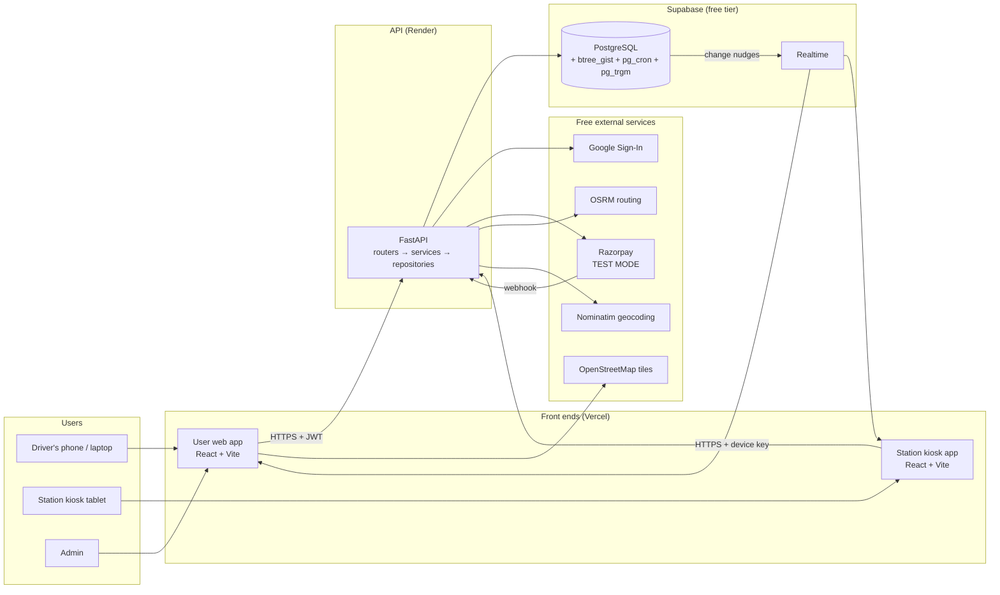
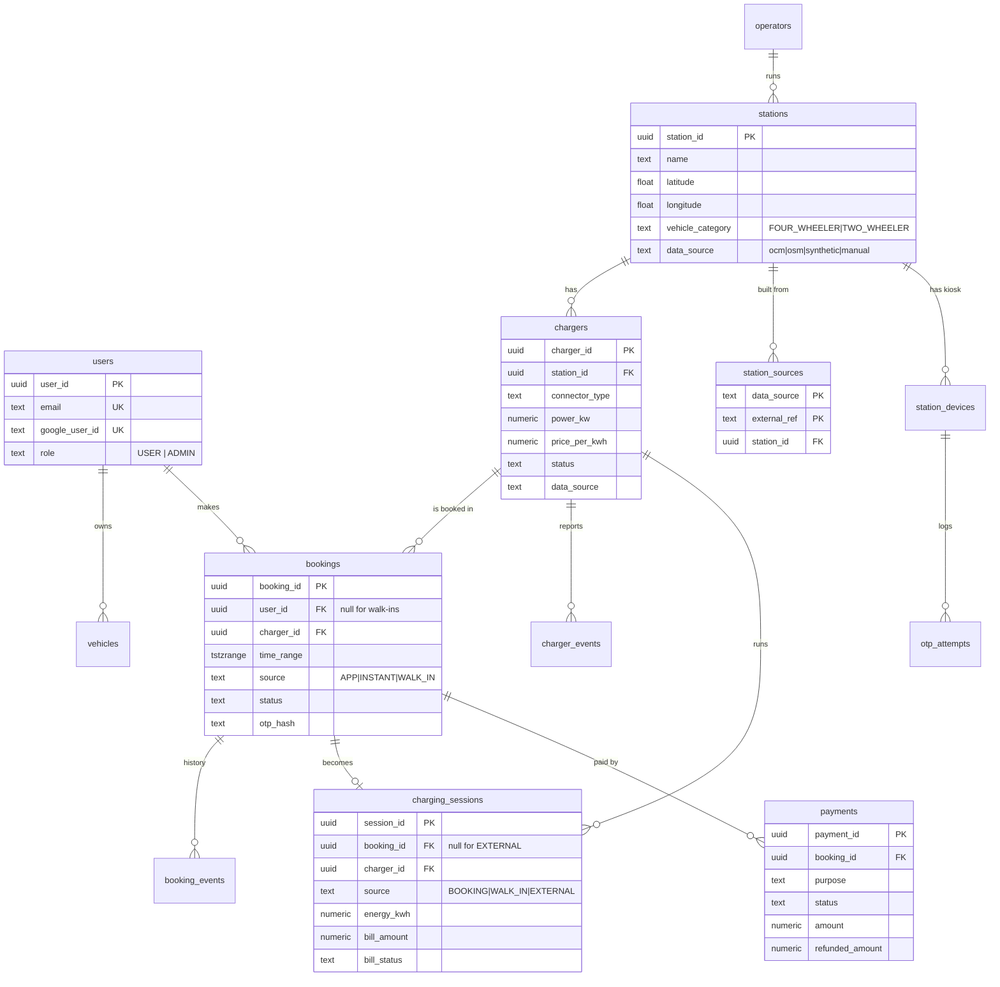
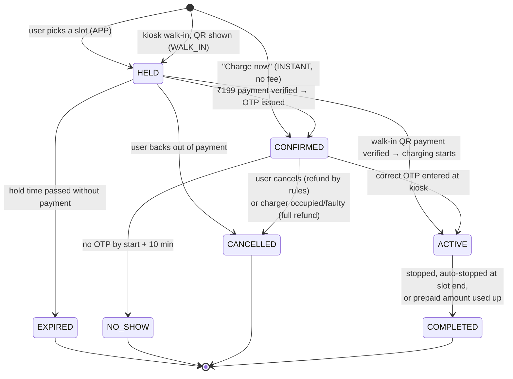
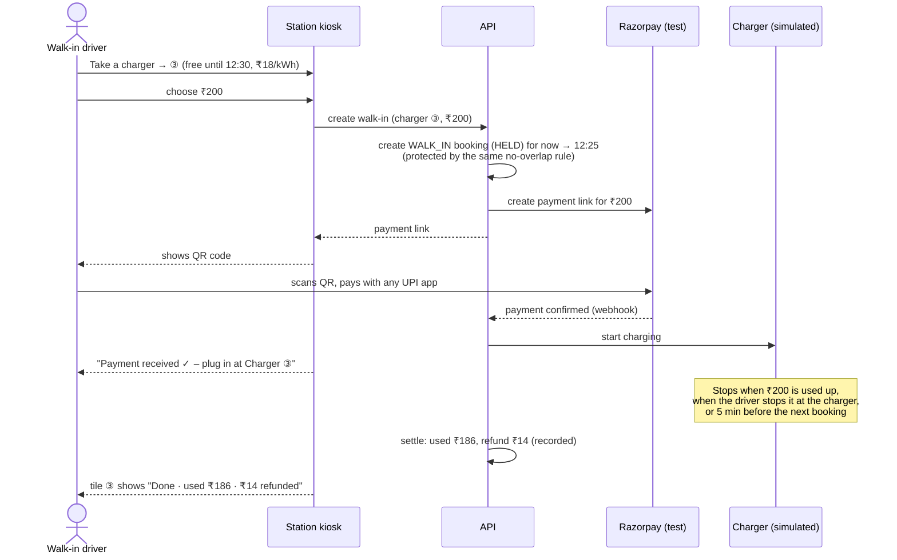
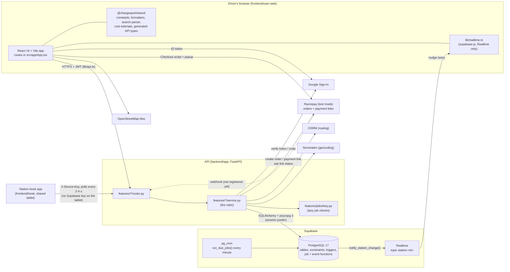

# ChargeSpot: Architecture

> **ChargeSpot is "BookMyShow for EV charging".** Drivers find nearby charging stations, see which chargers are free, book a time slot, and start charging at the station with a one-time code. Drivers without a booking can still walk in and pay by QR at the station screen.

This document records **what we are building and why**. It is the reference for the team and the project jury. Every decision here was agreed during Phase 0 planning (October 2026).

---

## Contents

1. [The big picture](#1-the-big-picture)
2. [Technology choices](#2-technology-choices)
3. [Where we started (existing code)](#3-where-we-started-existing-code)
4. [Folder structure](#4-folder-structure)
5. [Data model](#5-data-model)
6. [Booking lifecycle](#6-booking-lifecycle)
7. [Charging flows](#7-charging-flows)
8. [Payments and refunds](#8-payments-and-refunds)
9. [The station kiosk](#9-the-station-kiosk)
10. [Background jobs](#10-background-jobs)
11. [Live updates (realtime)](#11-live-updates-realtime)
12. [Finding stations: recommendations and smart search](#12-finding-stations-recommendations-and-smart-search)
13. [Station data strategy](#13-station-data-strategy)
14. [Security](#14-security)
15. [Configuration values](#15-configuration-values)
16. [Free services and their limits](#16-free-services-and-their-limits)
17. [Build phases and team split](#17-build-phases-and-team-split)
18. [What is built today (code-derived)](#18-what-is-built-today-code-derived)

---

## 1. The big picture

ChargeSpot has **two front-end apps and one API**. Every rule about availability, booking, payment and charging lives in the API and the database. **The front ends never decide availability themselves.** They ask the API.



| Part | Who uses it | What it does |
|---|---|---|
| **User web app** | Drivers, admins | Search the map, see live availability, get "best station" suggestions, book and pay, receive the OTP, watch charging progress, pay the energy bill, manage bookings. Admins edit stations and chargers. |
| **Station kiosk app** | Anyone at the station | One shared screen per station. Shows every charger's status and progress. Starts charging, either with a booking OTP or by walk-in QR payment. |
| **API** | Both apps | All business logic: availability, bookings, payments, OTPs, charging sessions, scheduling, recommendations. |
| **Database** | API only | Stores everything, and **enforces the most important rule (no double booking) itself**. |

---

## 2. Technology choices

Everything is **free**. No paid service is used.

| Need | Choice | Why |
|---|---|---|
| User web app | React 19, Vite, TypeScript, Tailwind CSS (already built) | Existing, working app; we extend it rather than rewrite it. |
| Kiosk app | Same stack as the web app | The team already knows it. The two apps share types and constants. |
| API | **FastAPI (Python)**, kept from the existing project | Working Google sign-in is already built on it, and the jury has seen it. Python suits the data-import and scoring scripts. FastAPI generates live API docs at `/docs`, and pytest makes the concurrency test simple. |
| Database | PostgreSQL on **Supabase** | The `btree_gist` extension makes "no double booking" a database rule. `pg_cron` runs jobs every minute. Realtime pushes live updates. |
| Migrations | Numbered plain `.sql` files plus a small Python runner | Easy for a reader to follow; the booking constraint has to be written in raw SQL anyway. Replaces the old `create_all()` call, which could never change existing tables. |
| Background jobs | **pg_cron** (inside the database) | Render's free tier puts the API to sleep after about 15 idle minutes, so a timer inside the API would stop firing. pg_cron runs inside Supabase around the clock. |
| Payments | **Razorpay test mode** | Free; supports UPI, cards and netbanking. The API verifies every payment with Razorpay's signature, never by trusting the browser. |
| Maps | Leaflet with **OpenStreetMap** tiles | Free with attribution and no key. A CSS filter darkens them to match the UI. (CARTO basemaps now require an API key, so we don't use them.) |
| Routing / travel time | OSRM public server, falling back to straight-line distance | Free. One request per recommendation. |
| Address search | Nominatim (OpenStreetMap), called through the API with a cache | Free. Its usage policy forbids search-as-you-type, so we geocode only when the user presses Search. |
| Search suggestions | PostgreSQL **`pg_trgm`** (fuzzy text matching, built into Supabase) | Free and inside our own database. Suggestions while typing come only from our data, so typos like "tata powr" still match without calling any outside service. |
| Shared front-end types | TypeScript types generated from the API's OpenAPI spec (`openapi-typescript`) | The two apps always match the API without hand-copying types. |
| Kiosk QR codes | `qrcode.react` | Tiny, MIT-licensed. Draws the walk-in payment QR. |
| Hosting | Vercel (both front ends), Render (API) | Free tiers. |

**Time zones:** all times are stored in **UTC** (`timestamptz`) and displayed in **Asia/Kolkata (IST)**.

---

## 3. Where we started (existing code)

Phase 0 began with an audit of the existing code. Summary:

| Area | State | What we do with it |
|---|---|---|
| Google sign-in, email login, JWT (`backend/auth`, `routes/auth.py`, `AuthContext`) | Works. The Google ID token is already verified on the server. | **Keep.** Move into the new structure; fix the fixed OAuth `state` value and move hard-coded secrets and URLs into `.env`. |
| Routing (`App.tsx`, `ProtectedRoute`) | Works | **Keep.** |
| Map and station list (`Dashboard`, `StationMap`, `StationCard`) | Works, but one 361-line page does everything, fetches every station at once, defaults to San Francisco, shows `$` prices, and **invents values when data is missing** | Split into smaller files and hooks. Query by map area. Default to Ahmedabad. Use ₹. Show "unknown" or an "approximate data" badge instead of made-up numbers. |
| Domain API (`main.py`) | All routes in one file; most are **unauthenticated** (for example, anyone can list every user's email) | Rebuild as feature modules, each with proper authentication. |
| Database schema | Created by `create_all()`, hand-edited in DBeaver, no migrations, no overlap protection on reservations | Replace with numbered migrations (see section 5). |
| Station import script | Broken (writes columns that don't exist; falls back to San Francisco data) | Replace with new import scripts (see section 13). |
| Leftovers | Supabase-auth client, unused `Header.tsx` and `App.css`, committed `.vite/` folder, outdated README, "AI agent – coming soon" button | Remove. The Supabase client is reused only for Realtime. |
| Tests | None | Add (see section 17). |

---

## 4. Folder structure

One repository with **four top-level areas**, named for what they are, so a new teammate or the jury can find anything quickly:

| Folder | What it holds | Language |
|---|---|---|
| `backend/` | The API: every business rule | Python (FastAPI) |
| `frontend/` | Everything that runs in a browser: the driver web app, the station kiosk, and the code they share | TypeScript (React) |
| `database/` | The schema (migrations), demo data (seeds), station import scripts, and saved SQL queries | SQL + Python |
| `docs/` | Architecture, build plan, setup guide | Markdown |

The two front ends and their shared package form an **npm workspaces** monorepo (one `npm install` at the root). The backend is a separate Python project with its own virtual environment.

```
backend/
  app/main.py                    app setup, middleware, routers
  app/config.py                  every setting and business rule in one place
  app/db.py                      database connection
  app/core/                      error format, logging
  app/features/
    auth/                        Google + email login, JWT, require_admin
    stations/                    station search by map area or radius
    availability/                30-minute slot grid per charger, `occupancy.py` ("is it free?")
    recommendations/             scoring.py (pure functions), osrm.py
    search/                      search suggestions (stations, operators, cities) via pg_trgm
    bookings/                    state_machine.py, otp.py, refunds.py, service.py, repository.py
    payments/                    Razorpay orders, signature check, webhook, refunds
    charging/                    sessions: live numbers, stop, start; energy.py (the energy formula); billing
    kiosk/                       device keys, status board, OTP start, walk-ins, admin key endpoints
    chargers/                    charger simulator (fake OCPP events), admin endpoint
    jobs/                        lazy checks: runs the SQL background jobs for a station before a read
    geocoding/                   Nominatim proxy + cache
    vehicles/                    the user's vehicles
    admin/                       station/charger editing, reports, alerts  (PLANNED, Phase 7: not built)
  scripts/                       demo tools: simulate.py (charger events, start a session, run jobs), make_admin.py
  tests/
frontend/
  user-web/                      the driver web app (also hosts the admin pages)
    src/app/                       App.tsx, routes
    src/components/layout/         Navbar and other page chrome
    src/features/auth/             AuthContext, login/register, ProtectedRoute
    src/features/home/             landing page
    src/features/stations/         map, list, search, station page
    src/features/bookings/         slot grid, checkout, confirmation, My Bookings
    src/features/charging/         live session page, energy bill payment
    src/features/admin/            station/charger editor, reports
    src/lib/                       api client, realtime
  kiosk/                         the station screen (built in Phase 6)
    src/features/device/           one-time device setup (API key)
    src/features/status-board/     charger tiles: availability + progress
    src/features/otp-start/        "Start with OTP"
    src/features/walk-in/          "Take a charger" + payment QR
  shared/                        @chargespot/shared: constants (statuses, connector
                                 types), ₹ and IST formatting, generated API types
database/
  migrate.py                     applies migrations in order
  migrations/                    001_extensions.sql, 002_users_vehicles.sql, …
  seeds/                         synthetic chargers, demo users, bookings and kiosk devices
  imports/                       OSM + Open Charge Map import, normalise, dedupe
  queries/                       saved read-only SQL for DBeaver: reports, checks, demo
docs/                            architecture.md (this file), phases.md, setup.md, …
data/                            raw downloads and legacy CSVs (git-ignored, never committed)
```

**Inside each backend feature**, files follow the same pattern: **router** (HTTP), **service** (rules), **repository** (SQL), **schemas** (validation), **models** (tables). Front-end features keep their pages, components and hooks together in one folder.

---

## 5. Data model

### 5.1 Overview



**Naming:** primary keys are `<table>_id` (UUID), matching the existing code so the auth module needs almost no changes. Fixed lists such as statuses are `text` columns with a `CHECK` constraint, which is easier to change later than PostgreSQL enums.

### 5.2 Tables

| Table | Key columns | Notes |
|---|---|---|
| `users` | email (unique, lower-case), full_name, phone, google_user_id (unique), password_hash (optional), role `USER`/`ADMIN` | From Google sign-in or email registration. |
| `vehicles` | user_id, nickname, connector_type, battery_kwh | One default vehicle per user (partial unique index). |
| `operators` | name (normalised, unique), website | "Tata Power", "Jio-bp", … Duplicate spellings are merged on import. |
| `stations` | name, address, city, state, postcode, latitude, longitude, operator_id, **vehicle_category**, amenities, opening hours, rating, is_active, **data_source**, **estimated_fields** | `vehicle_category` is `FOUR_WHEELER` or `TWO_WHEELER`; the app shows four-wheeler stations for now. `estimated_fields` lists generated values (e.g. `{rating}`). Indexed on (latitude, longitude). |
| `station_sources` | **(data_source, external_ref)** primary key, station_id | Every outside record a station was built from, e.g. `('osm', 'node/123')`, `('ocm', '257048')`. When duplicates merge, their records point at the survivor, so re-running an import updates it instead of re-creating the duplicate. |
| `chargers` | station_id, label (e.g. "CCS2-1", unique per station), connector_type, current_type `AC`/`DC`, power_kw, price_per_kwh, **status**, **data_source**, **estimated_fields** | **One row = one bookable plug.** `data_source` is per charger because an imported station can have synthetic chargers; `estimated_fields` marks a real charger's generated values (e.g. `{price_per_kwh}`). |
| `bookings` | user_id, charger_id, vehicle_id, **time_range**, **source**, **status**, hold_expires_at, otp_hash, otp_used_at, booking_fee, refund_amount, cancelled_at | See 5.3 for the constraints. |
| `booking_events` | booking_id, from_status, to_status, actor `USER`/`DEVICE`/`SYSTEM`/`ADMIN`, reason, at | Written automatically by a trigger. A full audit trail of every status change. |
| `charging_sessions` | booking_id, charger_id, device_id, **source**, started_at, ended_at, end_reason, energy_kwh, **bill_amount**, **bill_status**, prepaid_amount, paid_at | Live energy and % are **calculated** from elapsed time × charger power, not stored every second. |
| `payments` | booking_id, **purpose** `BOOKING_FEE`/`ENERGY`/`WALKIN_PREPAID`, provider `razorpay`, provider_order_id (unique), provider_payment_id (unique), amount, status, refunded_amount | Each refund is recorded against its payment. |
| `webhook_events` | provider_event_id (primary key), payload, received_at, processed_at | Razorpay may send the same webhook twice; we process each event once. |
| `station_devices` | station_id, name, api_key_hash, key_prefix, is_active, last_seen_at | One kiosk per station. The key is stored only as a hash. |
| `otp_attempts` | device_id, attempted_at, success | Used for the kiosk's wrong-OTP cooldown. |
| `charger_events` | charger_id, event (`AVAILABLE`, `CHARGING`, `FINISHED`, `FAULTED`, …), source, at | Simulated OCPP messages (see 7.4). |
| `geocode_cache` | normalised query, result, fetched_at | Avoids repeating Nominatim calls. |

**Lists used in CHECK constraints** (mirrored in `frontend/shared`). Lists used by several tables are PostgreSQL **domains** (named column types with a built-in check: `connector_type`, `data_source`, `money_inr`), so every table uses the same definition:

- **Data source:** `manual`, `ocm`, `osm`, `synthetic`
- **Vehicle category (stations):** `FOUR_WHEELER`, `TWO_WHEELER`
- **Connector types:** `CCS2`, `TYPE2`, `CHADEMO`, `BHARAT_AC001`, `BHARAT_DC001` (displayed as "Bharat DC-001 (GB/T)"), `TYPE1`, `OTHER`
- **Charger status** (the live physical state, reported by the charger): `AVAILABLE`, `RESERVED`, `CHARGING`, `FAULTED`, `OUT_OF_SERVICE`
- **Booking source:** `APP` (booked ahead, ₹199 fee), `INSTANT` ("Charge now" in the web app, no fee), `WALK_IN` (kiosk QR, no account)
- **Booking status:** `HELD`, `CONFIRMED`, `ACTIVE`, `COMPLETED`, `EXPIRED`, `CANCELLED`, `NO_SHOW`
- **Session source:** `BOOKING`, `WALK_IN`, `EXTERNAL` (someone used the operator's own app or card)
- **Bill status:** `DUE`, `PAID`, `PREPAID_SETTLED`

### 5.3 The rule that prevents double booking

The most important rule in the project is enforced **by PostgreSQL itself**, not by application code. Two people pressing "Book" at the same instant cannot both succeed:

```sql
-- One charger can never have two live bookings whose time ranges overlap.
-- (database/migrations/004_bookings.sql)
CONSTRAINT bookings_no_double_booking
  EXCLUDE USING gist (
    charger_id WITH =,      -- same charger
    time_range WITH &&      -- overlapping time
  )
  WHERE (status IN ('HELD', 'CONFIRMED', 'ACTIVE'));
```

Why this matters: an application-level check ("is the slot free? then insert") has a gap between the check and the insert, so two requests can both pass the check. The database constraint has no gap. When it rejects a booking (error code `23P01`), the API replies **"This slot was just taken"** together with alternative times and chargers.

**When two bookings arrive at exactly the same instant**, each waits for the other to finish, and PostgreSQL may break the tie by cancelling one with a **deadlock** error (`40P01`) instead of `23P01`. A double booking still cannot happen. The API's rule: **on `40P01`, retry the booking once**; the retry then gets a clean `23P01`. The concurrency test in `database/tests/` does exactly this and passes reliably.

The constraint covers **every** way a charger gets used: app bookings, instant bookings and kiosk walk-ins are all rows in `bookings`. A walk-in can therefore never overlap an app booking.

Other database rules:

- `time_range` must have its start before its end, using `[start, end)` bounds.
- **One hold per user at a time** (`UNIQUE (user_id) WHERE status = 'HELD'`), so nobody can hoard slots.
- `user_id` is required unless `source = 'WALK_IN'`.
- A trigger rejects **illegal status changes** (see section 6), even when they come from a background job.
- **Row-level security is switched on for every table with no policies.** Supabase exposes tables through its public REST API, and this blocks that route completely. Only our API, using the database connection string, can read or write data.

---

## 6. Booking lifecycle

### 6.1 States



All transitions live in **one module** (`bookings/state_machine.py`). A database trigger enforces the same table of allowed transitions, so neither the API nor a background job can make an illegal change.

### 6.2 Rules

| Rule | Value |
|---|---|
| Slot size | **30-minute blocks**; a booking is **1–4 blocks** |
| Payment hold | A new `APP` booking is `HELD` for **5 minutes**. Razorpay Checkout is given a slightly shorter timeout so it closes first. |
| Booking fee | **₹199** for `APP` bookings. **No fee** for `INSTANT` and `WALK_IN`. |
| OTP | **6 digits**. Valid from **start − 15 min to start + 10 min**. **Single use to start charging.** |
| Reservation lock | At **start − 15 min** the charger is told to reserve itself for this booking (see 7.4). |
| No-show | No OTP by **start + 10 min** → `NO_SHOW`. **The ₹199 fee is kept.** The charger is free for the rest of the window. |
| End of slot | Charging **stops automatically at slot end**, with a warning **5 minutes before**. |
| Unpaid bills | A user with an unpaid energy bill **cannot make a new booking** until it is paid. |

**Lazy checks:** stale holds and missed OTPs are resolved **when anyone looks at a charger**, not only when the job runs. Before creating a booking, the API expires old holds on that charger in the same transaction. Correctness therefore never depends on when the background job last ran.

### 6.3 Cancellation refunds (of the ₹199 fee)

| Cancelled | Refund |
|---|---|
| **2 hours or more** before start | **100%** (₹199) |
| **30 minutes to 2 hours** before | **75%** (₹149.25) |
| **15 to 30 minutes** before | **50%** (₹99.50) |
| **Less than 15 minutes** before | **0%** |
| No-show | **0%** (fee kept) |
| Charger occupied or faulty at start, with no alternative charger | **100%**, not the user's fault |

In test mode, refunds are calculated and **recorded**, not sent as real money.

---

## 7. Charging flows

### 7.1 App booking (booked ahead)

```mermaid
sequenceDiagram
    actor D as Driver (web app)
    participant API
    participant DB as Database
    participant RZ as Razorpay (test)
    participant K as Station kiosk
    participant C as Charger (simulated)

    D->>API: Book charger ③, 10:00–11:00
    API->>DB: INSERT booking (HELD, expires in 5 min)
    alt slot already taken
        DB-->>API: exclusion violation (23P01)
        API-->>D: "Slot just taken" + alternatives
    end
    API->>RZ: create ₹199 order
    D->>RZ: pay (UPI / card / netbanking)
    D->>API: payment result + signature
    API->>API: verify signature
    API->>DB: HELD → CONFIRMED, store OTP hash
    API-->>D: OTP 482913 (shown once; can be regenerated)

    Note over API,C: 09:45: reservation lock sent to charger ③

    D->>K: enters OTP 482913
    K->>API: start (device key + OTP)
    API->>DB: CONFIRMED → ACTIVE, create session
    API->>C: start charging
    K-->>D: "Go to Charger ③, plug in"

    Note over D,API: Driver watches progress on their phone

    API->>C: stop at 11:00 (warning at 10:55)
    API->>DB: ACTIVE → COMPLETED, bill = kWh × price
    API-->>D: "Charging complete – pay ₹223.20"
    D->>RZ: pay energy bill in the web app
    API->>DB: bill PAID
```

### 7.2 Instant booking ("Charge now" in the web app)

For a signed-in user who is already at, or near, a free charger:

1. On the station page, tap **Charge now** on a free charger. This books the time from now until the earlier of that charger's next booking (minus 5 minutes) or 1 hour.
2. **No ₹199 fee.** The booking goes straight to `CONFIRMED` and the OTP appears immediately.
3. From here it is identical to 7.1: OTP at the kiosk, live progress on the phone, energy bill paid in the web app.

### 7.3 Kiosk walk-in (no app, no account)

> Built in Phase 6: `features/kiosk/walkin.py`, migration 014 (settlement) and `frontend/kiosk/`. While no webhook is registered, the kiosk's own poll asks Razorpay about the payment link; a payment that arrives late is refunded in full. See section 18 and `docs/FLOW.md` section 12.



- **Pay first, then charge.** Razorpay confirms the payment before the charger starts, so nobody can leave without paying, and no staff are needed.
- **No phone number or SMS.** The walk-in is identified only by their payment. Sending SMS codes would cost money.
- ChargeSpot collects the money and **records the operator's share** for later payout, the same way aggregator apps work.
- While the QR is on screen, the walk-in booking is `HELD` (just like an app booking waiting for payment). If payment isn't completed within **3 minutes**, it becomes `EXPIRED` and the charger is freed.

### 7.4 Chargers used outside ChargeSpot

> Built in Phase 5: `simulate_charger_event` (migration 011) and `POST /api/admin/chargers/{id}/simulate`. A charger's status changes only through these events, each one is logged in `charger_events`, and an outside start is refused while the charger is reserved.

Stations belong to real operators, and drivers can also start a charger with the operator's own app or card. Real chargers report their status to the operator using a standard protocol called **OCPP**. OCPP can also **reserve** a charger so that only one customer can start it.

We cannot connect to real chargers, so the API includes a **charger simulator** that produces the same kinds of events. The admin page has a **"Simulate external session"** button for demos.

| Situation | What happens |
|---|---|
| No booking right now | Anyone may use the charger. An outside session appears as **"Busy"**, and that time block isn't offered to app users. |
| 15 minutes before a booking | The charger is **reserved** and rejects outside starts. |
| An outside session is still running when the lock time comes | The booked driver is warned that the charger may be busy. The system checks again at the start time. |
| Still occupied at the start time | ① **Move the booking to another free compatible charger** at the same station and tell the driver. ② If none is free, **cancel with a 100% refund** and show nearby alternatives. The driver is never penalised. |

---

## 8. Payments and refunds

> Built in Phase 6: the energy bill (`ENERGY`, paid in the web app) and the walk-in prepayment (`WALKIN_PREPAID`, a Razorpay payment link). Refunds are still recorded, not sent.

| What | Who pays | How | Verified by |
|---|---|---|---|
| **Booking fee ₹199** (APP bookings) | Signed-in user | Razorpay Checkout in the web app | Razorpay signature, checked by the API |
| **Energy bill** (APP and INSTANT bookings) | Signed-in user | Razorpay Checkout in the web app, after charging | Razorpay signature; webhook as a backup |
| **Walk-in prepayment** | Anyone at the kiosk | QR code on the kiosk → Razorpay payment link | Razorpay webhook, **before** charging starts |
| Refunds | — | Calculated by the API and recorded (test mode) | — |

**Rules that apply to every payment:**

- **Amounts are calculated only on the server.** Front ends display them; they never send them.
- A payment is marked paid **only** after the API has verified it with Razorpay.
- Each Razorpay webhook event is processed once (`webhook_events` table).
- A bill that is already paid cannot be charged again.
- The kiosk **never shows bills or personal details** for app users. Those live in the web app behind login.

**Energy bill** = energy delivered (kWh) × charger's price per kWh, rounded to 2 decimals. In the simulation, energy = charger power × charging time × an efficiency factor, limited by the vehicle's battery size.

---

## 9. The station kiosk

> Built in Phase 6 (`frontend/kiosk/`, `backend/app/features/kiosk/`). The kiosk polls the API instead of using Realtime, so no Supabase key sits on a shared tablet. Staff steps and the manual test script: `docs/kiosk.md`.

**One kiosk per station, shared by everyone**, like an ATM. Each person uses it for under a minute. Everything personal happens on their own phone.

```
┌──────────────────────────────────────────────────────────┐
│  ChargeSpot · Tata Power – Gota                 10:42 AM │
├──────────────────────────────────────────────────────────┤
│ ① CCS2 60kW   CHARGING   ███████░░ 72%   ends 11:00      │
│ ② CCS2 60kW   RESERVED   for 11:00 booking               │
│ ③ Type2 22kW  AVAILABLE  free until 12:30 · ₹18/kWh      │
│ ④ CCS2 30kW   CHARGING   walk-in · ₹120 of ₹200 used     │
├──────────────────────────────────────────────────────────┤
│ [ Start with OTP ]   booked in the ChargeSpot app        │
│ [ Take a charger ]   no booking? pay by UPI QR here      │
└──────────────────────────────────────────────────────────┘
```

| Feature | Design |
|---|---|
| **Status board** | Every charger's state, progress and "free until" time, updated live. **No names, phone numbers or bills.** |
| **Start with OTP** | For app and instant bookings. The OTP matches exactly one booking at this station, which tells the kiosk which charger to start. |
| **Take a charger** | Walk-in flow (section 7.3). The price and payment method are shown before anyone starts. |
| **Stopping and paying** | Not on the kiosk. App users use the web app. Walk-ins stop at the charger, or charging auto-stops. |
| **Auto-reset** | After **30 seconds** without a touch, the kiosk returns to the status board. |
| **Wrong OTPs** | After **5 wrong tries**, a **2-minute cooldown**. A hard lockout would let one person block everyone. **20+ wrong tries in 10 minutes** raises an alert on the admin page. |
| **Device login** | The kiosk signs in as a **station device** with a per-station API key, entered once during setup and stored only as a hash on the server. It can act only on its own station. |

---

## 10. Background jobs

Jobs run **every minute** using **pg_cron** inside the database. Each job is a SQL function, so tests can call it directly.

| Job | What it does |
|---|---|
| `expire_holds()` | `HELD` bookings past their hold time (5 min for app bookings, 3 min for walk-in QR) → `EXPIRED` |
| `apply_reservation_locks()` | Reserve chargers whose booking starts in ≤ 15 minutes |
| `resolve_occupied_starts()` | Booking start time reached but the charger is busy → move to another charger, or cancel with a full refund |
| `mark_no_shows()` | No OTP by start + 10 min → `NO_SHOW`, fee kept |
| `auto_stop_sessions()` | Stop sessions at slot end, when a walk-in's prepaid amount is used up, or 5 minutes before the next booking. Calculate the bill. |

Every job function takes the current time as an optional parameter (`p_now timestamptz DEFAULT now()`), so tests can simulate any moment without waiting.

**As built (migrations 011 and 012):** `run_due_jobs(p_now, p_station)` runs the five jobs in the order that gives the right answer, and one pg_cron entry (`chargespot-jobs`) calls it every minute. Each job can also be limited to one station. The API runs the same function for the station involved just before availability, booking and session reads (the *lazy checks*, section 6.2), so a hold that ran out, a missed code, a session past its end or an occupied charger is dealt with the moment anyone looks. Sessions are ended by `finish_session`, which works out the energy and the bill with the same formula the live page uses:

> energy = charger power x hours x 0.9 efficiency, never more than the battery has room for (battery size x (100% - start level)); without a vehicle the default 40 kWh battery is used, and a session starts at an assumed 20% charge. Bill = energy x the charger's price per kWh.

What a job does to a booking is shown to the driver: a booking moved to another charger carries the notice *"Moved from CCS2-1 to CCS2-2, same time."*, a driver whose charger is still busy at lock time gets a warning, and a booking cancelled because no charger was free carries *"Cancelled ... fee refunded in full"* (the refund is whatever was actually paid).

**Why pg_cron instead of a scheduler inside the API?** The free Render server sleeps when idle, so an in-app timer would silently stop. pg_cron keeps running inside Supabase. The lazy checks in section 6.2 add a second layer of safety.

---

## 11. Live updates (realtime)

When a booking or charger changes, a database trigger sends a small **"something changed"** message through Supabase Realtime, for example `{ station_id, charger_id }`. The web app and kiosk then **re-fetch fresh data from the API**.

- The message carries no booking details, so nothing private leaks through Realtime.
- The API stays the **single source of truth**. Realtime is only a nudge to refresh.

**As built (migration 013):** triggers on `bookings`, `chargers` and `charging_sessions` call `realtime.send(...)` with `{station_id, charger_id}` on the topic `station:<id>`. Where Realtime does not exist (a plain PostgreSQL) they do nothing, and an error in Realtime never breaks a booking. In the web app, `lib/realtime.ts` shares one Supabase connection and one channel per station; `useRealtimeRefresh` re-fetches from the API when nudged (several nudges at once cause one refresh), polls every 30 seconds when live updates are down, and the app bar shows a "Reconnecting..." banner meanwhile. The map listens to the 20 nearest stations on screen; the station page, the Bookings list, the ticket and the charging page listen to their own stations.

---

## 12. Finding stations: recommendations and smart search

### 12.1 "Best station" recommendations

`GET /recommendations?lat&lng&connector&start&duration`

1. Find stations within **15 km** that have chargers matching the connector type.
2. Take the nearest candidates by straight-line distance and ask **OSRM** for driving times **in one request**. If OSRM fails, estimate time from straight-line distance at 25 km/h.
3. Score each station with a **weighted formula**. The weights are a config object, so they're easy to tune and explain:

| Factor | Better when… |
|---|---|
| Travel time | shorter |
| Compatible chargers free for the requested time | more |
| Charging power (kW) | higher |
| Price per kWh | lower |
| Rating | higher |
| Data quality | real data scores slightly higher than synthetic |

4. Return the top results with a short **reason**, for example *"2 CCS2 chargers free · 1.2 km · 60 kW"*.

The scoring code is **pure functions** with no database or network access, so it has its own unit tests.

### 12.2 Smart search (Explore)

> Built in Phase 3 (task 3.10). Migration `010_search.sql` enables `pg_trgm` and adds the indexes.

One search box on Explore understands station names, operators, plug types, power, opening hours, price, "near me" and places, alone or combined, for example *"fast ccs2 near Bopal"*.

| Typed | Understood as | Filter in the page address |
|---|---|---|
| `Bopal`, `near Bopal`, `in Gandhinagar` | a place: the map moves there | (map view) |
| `Tata Power` | an operator: only their stations | `operator` |
| `ccs2`, `type 2`, `chademo`, `bharat dc` | plug type | `connector` (repeatable) |
| `60kw`, `fast`, `dc` | minimum power (`fast` = 50 kW+) | `fast` / `min_kw` |
| `open now`, `24 hours` | opening hours | `open` |
| `cheap`, `under 15` | maximum price per kWh (₹); `cheap` = ₹15 | `max_price` |
| `dc`, `ac` | the DC plugs (CCS2, CHAdeMO, Bharat DC-001) or the AC plugs | `connector` |
| `near me`, `nearby` | the user's location | (geolocation) |

**How it works:**

1. **The browser reads the query.** A pure function, `parseSearch(text)` in `@chargespot/shared` (unit-tested with Node's built-in test runner), picks out the words it knows (using the shared connector lists, so nothing drifts from the database). Whatever is left over is the name or place part. Unknown words are never guessed into filters.
2. **Suggestions while typing come only from our database.** `GET /api/search/suggest?q=&lat=&lng=` (login required) returns the top stations (matched by name, or by address so "Bopal" finds stations on Bopal roads), operators and cities, each operator and city with its station count and map area. The browser waits 250 ms after the user stops typing. Matching uses **`pg_trgm`** word similarity with trigram indexes on station name, operator and city. Ranking puts a name that starts with the text first, then a name that contains it, then an address that contains it, then similar spellings; ties go to the nearest station. A fixed number of queries per request (tested). Only four-wheeler stations are included. A close-but-not-exact match returns a **"Did you mean …?"** suggestion. Thresholds live in `config.py`.
3. **Places only on Enter.** Nominatim is called **only when the search is submitted**, through `/api/geocode`, and the result is cached (section 16). It is never called while typing.
4. **Results follow the query.** The filters that were picked out become selected chips and are saved in the page address, so a search can be shared and Back works. The map moves to the station, operator area, city or place, and the list updates.

**Interface:**

- **Desktop:** a dropdown under the search bar over the map, with these sections: **Understood** (the chips that were picked out, each removable), **Stations** (with live "2/3 free" badges), **Operators**, **Cities**, **Places** ("press Enter"), and **Recent**.
- **Phone:** tapping the box opens a full-screen search sheet with the same sections and large touch targets. Picking a result returns to the map with the results in the bottom sheet.
- **Empty box:** example searches and quick chips (Near me · Fast · Open now · CCS2).
- **No results:** names the filter that hides the most stations and offers one tap to remove it.
- **Recent searches:** the last 5, stored only in that browser, never sent to the API.
- **Accessibility:** the dropdown is an ARIA combobox (arrow keys, Enter, Esc) that announces how many results there are.

---

## 13. Station data strategy

Real Indian charging data is incomplete, especially prices and connector details. Our approach (full details, step by step, in [data.md](data.md)):

1. **Keep the 10 hand-verified Ahmedabad stations** from the old database (`VERIFY-ST-001` to `010`, operators such as Tata Power, IOCL, CESL and Jio-bp) as `data_source = manual`.
2. **Import Gujarat first** from Open Charge Map (free API key) and OpenStreetMap (Overpass API, `amenity=charging_station`). Other states can be added later by changing one setting.
3. **Clean the data:**
   - **Check location:** points are tested against Gujarat's real boundary (from OpenStreetMap). Records whose address names another state are skipped, because their coordinates are wrong.
   - **Remove duplicates:** stations within **~50 m** with similar names are merged (manual > ocm > osm); every merge goes into a report.
   - **Merge operator spellings,** e.g. `tata`, `TATA`, `Tata power`, `Tata Power EZ Charge` → **Tata Power**.
   - **Standardise connector names** to our list (GB/T → Bharat DC-001, and so on).
   - **Drop things that aren't chargers:** battery-swap points (Honda e:swap, Battery Smart, Sun Mobility), bike stations (Yulu), phone-charging points.
   - **Tag two-wheeler stations** (Ather Grid, Ola, scooter-only plugs) as `TWO_WHEELER` instead of deleting them. The app shows four-wheeler stations only; a two-wheeler section can be added later without re-importing.
4. **Fill gaps with synthetic data,** clearly labelled. Stations with no charger details get realistic chargers based on the operator (`data_source = synthetic`); real chargers missing power or price get estimates (listed in `estimated_fields`). Ahmedabad also gets a week of demo bookings so the slot grid looks realistic.
5. **Be honest in the UI.** Anything synthetic or estimated shows a small **"approximate data"** badge. Unknown values show "unknown" and are never invented.
6. **Admin page** to add or correct stations and chargers by hand (`data_source = manual`).

**Licences:** OpenStreetMap data is ODbL and Open Charge Map is CC BY 4.0. Both require attribution, shown in the app footer and the README.

The old exported CSVs live in `data/legacy/` and are **git-ignored**. The exported `users.csv` is **not** used; accounts are copied once from the old database itself, without test accounts, so existing logins keep working.

---

## 14. Security

| Area | Measure |
|---|---|
| Secrets | Only in `.env` files, never committed. Each app has a `.env.example`. **The database password that was committed in the old `database.py` must be changed** and removed from the code. |
| User sign-in | Google ID token verified on the server; the API issues its own JWT. The OAuth redirect flow gets a random `state` value. |
| Authorisation | Every user route requires login, and users can only see their own bookings, sessions and bills. Admin routes require `role = ADMIN`. |
| Kiosk | Per-station API key, stored as a hash; it can act only on its own station. |
| OTP | Stored as an **HMAC-SHA256** with a server secret, because a plain hash of a 6-digit code can be cracked in seconds. Unique among live bookings at the same station. Valid only in its time window. Wrong-attempt cooldown on the kiosk. |
| Database | Row-level security on every table blocks Supabase's public REST API. Only the API connects. |
| Payments | Server-calculated amounts, Razorpay signature checks, one-time webhook processing. |
| CORS | Allowed origins come from config, not hard-coded localhost. |

---

## 15. Configuration values

All of these live in `backend/app/config.py`, so they can be changed without touching business logic.

| Setting | Value |
|---|---|
| Slot length | 30 min |
| Blocks per booking | 1–4 |
| Payment hold (app booking) | 5 min |
| Walk-in QR hold | 3 min |
| How far ahead users can book | 7 days |
| Booking fee (APP) | ₹199 |
| OTP valid from / until | start − 15 min / start + 10 min |
| Reservation lock | start − 15 min |
| No-show after | start + 10 min |
| End-of-slot warning | 5 min before |
| Walk-in / instant buffer before next booking | 5 min |
| Instant booking maximum | 1 h |
| Walk-in amounts | ₹100, ₹200, ₹500, or "until the next booking" |
| Refund tiers | ≥ 2 h: 100% · 30 min–2 h: 75% · 15–30 min: 50% · < 15 min: 0% |
| Kiosk wrong-OTP cooldown | 5 tries → 2 min |
| Kiosk alert threshold | 20 wrong tries / 10 min |
| Kiosk idle reset | 30 s |
| Recommendation radius | 15 km |
| Search suggestions | wait 250 ms after typing; top 5 stations, 3 operators, 3 cities; fuzzy-match thresholds in `config.py` |
| Duplicate-station distance | ~50 m |
| Display time zone | Asia/Kolkata |

---

## 16. Free services and their limits

| Service | Limit or risk | How we handle it |
|---|---|---|
| Supabase free tier | Pauses after 7 days without activity. Direct database connections are IPv6-only. | Open the project regularly. The API uses Supabase's **session pooler** connection string, which Render can reach. |
| Render free tier | Sleeps after ~15 idle minutes; ~30 s cold start | Background jobs run in pg_cron instead. Open the app a minute before a demo. |
| Razorpay test mode | No real money moves | Exactly what we want. Refunds are recorded, not sent. |
| Razorpay webhooks | Need a public URL | Works on Render. Locally, a free tunnel (e.g. cloudflared) or rely on the signature check alone. |
| OSRM public server | Light use only; no uptime guarantee | One request per recommendation, plus the straight-line fallback. |
| OpenStreetMap tile server | Fair use only (light traffic, attribution shown, no bulk downloading) | Fine for a college project and demo. For real production traffic, switch to a free-tier tile provider with a key. |
| Nominatim | Max 1 request/s; no search-as-you-type | Search only on submit, through the API, with a cache. |
| Overpass / Open Charge Map | Rate limits | Imports are run occasionally by a script, not by users. |

---

## 17. Build phases and team split

Each phase ends with a review. The next phase starts only after approval.

| Phase | Scope | Effort |
|---|---|---|
| **0** | Audit, decisions, this document | done |
| **1** | Monorepo restructure; split the API into feature modules; lock down routes; fix secrets and OAuth `state`; shared package and generated types; rename to ChargeSpot | 3–4 person-days |
| **2** | Database migrations (constraints, triggers, RLS, job functions); OSM and OCM import for Gujarat; dedupe and normalisation; synthetic seed | 5–6 person-days |
| **3** | Station search by area; availability grid; recommendations with tests; geocoding proxy; map and list UI fixes | 5–6 person-days |
| **4** | Slot picker (BookMyShow-style); hold and payment; OTP confirmation; My Bookings; cancellation with refunds; instant bookings | 7–8 person-days |
| **5** | pg_cron jobs; lazy checks; realtime updates; charger simulator and reservation locks | 4–5 person-days |
| **6** | Kiosk app: device setup, status board, OTP start, walk-in QR flow; energy billing and payment in the web app | 6–7 person-days |
| **7** | Admin page; edge cases; full test suite; README; jury demo script; deployment | 6–8 person-days |

**Suggested team split (4 people):**

| Person | Focus |
|---|---|
| A, backend core | Bookings, state machine, OTP, payments, jobs, concurrency tests |
| B, data and database | Migrations, imports, cleaning, synthetic seed, recommendation scoring, admin API |
| C, user web app | Map and search, slot grid, checkout, My Bookings, live session page, realtime |
| D, kiosk and delivery | Kiosk app, charger simulator UI, admin page, docs and diagrams, deployment, demo script |

With **3 people**, D's work is shared between B (kiosk API, admin) and C (kiosk UI).

**Tests we will write:**

- **Concurrency:** two simultaneous bookings for the same slot → exactly one succeeds.
- **State machine:** every allowed transition works; every illegal one is rejected, by both the API and the database.
- **OTP:** correct code, wrong code, outside the time window, reused code, cooldown.
- **Jobs:** hold expiry, no-show at +10 min, auto-stop, occupied-charger handling.
- **Refunds:** each cancellation tier boundary.
- **Recommendation scoring:** weights, ordering, and the "why" text.
- **Walk-ins:** a walk-in can't overlap a booking; unpaid walk-ins are released; leftover amounts are refunded correctly.

---

## 18. What is built today (code-derived)

Sections 1 to 17 are the design and the reasons, written during planning. This section describes **what the code does today** (as of 2026-10-21, Phases 0 to 6 included). When it disagrees with an earlier section, the code wins and this section says so. Read it with `docs/FLOW.md` (step-by-step flows), `docs/SCHEMA.md` (tables) and `docs/API.md` (endpoints).

### 18.1 In one paragraph

ChargeSpot is a three-part system in one repository: a **React web app** for drivers, a **FastAPI API** that holds every rule, and a **PostgreSQL database on Supabase** that enforces the most important rules itself (no double booking, legal status changes only) and runs the background jobs (`pg_cron`). The browser also listens to **Supabase Realtime** for "something changed" nudges, and the API talks to a few free outside services. A station **kiosk** app (`frontend/kiosk`) shows the chargers on a shared tablet, starts charging with a code and takes walk-in payments by QR.

### 18.2 Diagram



### 18.3 Components

| Component | Where | What it does | Notes |
|---|---|---|---|
| **Web app** | `frontend/user-web/` | The driver's app: map, station page, booking, tickets, live charging, vehicles | React 19, Vite 8, TypeScript, Tailwind CSS v4, React Router 7, Leaflet, lucide icons, `@supabase/supabase-js` (Realtime only) |
| **Shared package** | `frontend/shared/` (`@chargespot/shared`) | Constants mirroring the database lists, `formatINR` / IST formatters, `parseSearch`, `estimateEnergy`, design tokens (`frontend/shared/src/styles/tokens.css`), generated `api-types.ts` | Consumed as TypeScript source: no build step |
| **API** | `backend/app/` | Every business rule; authentication; talks to the outside services | Python 3.12, FastAPI, SQLAlchemy 2, psycopg 3, Pydantic, PyJWT, bcrypt, httpx, razorpay SDK |
| **Database** | `database/migrations/` (schema), Supabase | Stores everything; enforces overlaps and status rules; runs the jobs | PostgreSQL 17 with `btree_gist`, `pg_trgm`, `pg_cron` |
| **Database tooling** | `database/` | Migration runner, station imports, synthetic and demo data, saved SQL | `python -m database.pipeline`, `python -m database.migrate` |
| **Demo tools** | `backend/scripts/` | `simulate.py` (charger events, start a session, run jobs), `make_admin.py`, `make_kiosk_key.py` | Run with `python -m scripts.<name>` from `backend/` |
| **Kiosk app** | `frontend/kiosk/` (`@chargespot/kiosk`) | Station status board, start with a code, walk-in QR payment | React 19, Vite 8, Tailwind v4, `qrcode.react`; dev port 5174; no router (a small state machine in `app/App.tsx`); key pasted once on the setup screen |

#### Outside services

| Service | Used for | Called from | Limits and fallback |
|---|---|---|---|
| **Google Sign-In** | Login | `features/auth/google.py`; the button in `features/auth/GoogleSignInButton.tsx` | Needs `GOOGLE_CLIENT_ID`; email login works without it |
| **Razorpay (test mode)** | The ₹199 booking fee, the energy bill (orders), walk-in prepayments (payment links) | `features/payments/gateway.py`; Checkout in `lib/razorpay.ts`; the kiosk shows the link as a QR | Test keys only; no real money; refunds are recorded, not sent; a link must live at least 15 minutes, so the 3-minute hold is ours |
| **OSRM** public server | Drive times for recommendations | `features/recommendations/osrm.py` | 3 s timeout, 60 s cache; falls back to straight-line at 25 km/h |
| **Nominatim** | Place search ("Bopal") | `features/geocoding/service.py` | 1 request per second, only on Enter, 30-day cache in `geocode_cache` |
| **OpenStreetMap tiles** | Map background | `features/stations/StationMap.tsx` | Fair use; attribution in `components/layout/Footer.tsx` |
| **Supabase Realtime** | Live nudges | database triggers (migration 013); `lib/realtime.ts` | If it drops: 30 s polling and a "Reconnecting..." banner |
| **Open Charge Map, Overpass (OSM)** | One-off station imports | `database/imports/` | Run by script, not by users |

### 18.4 Backend structure

`app/main.py` only builds the app. Each feature is a folder in `app/features/` with the same shape: `router.py` (HTTP), `service.py` (rules), `repository.py` (queries, where used), `schemas.py` (Pydantic), `models.py` (SQLAlchemy). Shared code is in `app/core/`.

| Feature | Responsibility | Notable files |
|---|---|---|
| `auth` | Register, login, Google, current user, admin check | `router.py`, `tokens.py` (JWT), `passwords.py` (bcrypt), `google.py`, `dependencies.py` (`get_current_user`, `require_admin`) |
| `stations` | Station search, detail, admin create | `repository.py` (`find_stations`), `service.py` (`build_summary`), `opening_hours.py` |
| `availability` | The 30-minute grid; "is it free?" in one place | `occupancy.py`, `service.py` |
| `recommendations` | "Best station" ranking | `scoring.py` (pure), `osrm.py`, `service.py` |
| `geocoding` | Place search with cache | `service.py` |
| `search` | Suggestions (stations, operators, cities) | `repository.py` (`pg_trgm`) |
| `vehicles` | A user's vehicles | `service.py` |
| `bookings` | Holds, instant bookings, codes, cancel, refunds | `state_machine.py`, `otp.py`, `refunds.py` (pure), `alternatives.py`, `instant.py`, `service.py` |
| `payments` | Razorpay orders (booking fee, energy bill), verify, webhook (also `payment_link.paid`) | `gateway.py` (orders, payment links), `service.py` (`confirm_payment`, `create_energy_order`, `verify_energy`) |
| `charging` | Sessions: live numbers, stop, start, bill payment routes, receipt | `energy.py` (pure), `service.py`, `receipt.py`, `router.py` |
| `admin` | Overview and reports, station and charger management, out of service with refunds, bookings list and history, devices (rename, replace key), alerts, users and roles, operators, payments, the activity log | `service.py` and `manage.py` (users, operators, payments, keys, activity), `router.py` (`/api/admin`), `alerts.py` (`raise_alert`, de-duplicated), `audit.py` (the activity log) |
| `kiosk` | Device keys, status board, OTP start with cooldown and alerts, walk-ins | `keys.py`, `dependencies.py` (`get_current_device`), `service.py` (board, `otp_start`), `walkin.py` (create, poll Razorpay, confirm, cancel), `router.py` (`/api/kiosk`), `admin_router.py` (keys) |
| `chargers` | Admin charger simulator | `service.py` |
| `jobs` | Lazy job checks | `lazy.py` |
| `core/` | Errors, logging, slots, geo, connector labels | `errors.py` (`AppError`), `slots.py` (IST, 30-minute blocks) |

Layering rule seen throughout: routers contain no rules; services own the rules and raise `AppError`; pure modules (`scoring.py`, `refunds.py`, `energy.py`, `slots.py`, `alternatives.free_starts_near`, `instant.instant_window`) have no database or network access so they can be unit-tested directly.

### 18.5 Web app structure

```
src/app/App.tsx            routes (public layout, signed-in layout, /dev/ui in development only)
src/components/layout/     PublicLayout, AppLayout (top bar, bottom tabs, charging pill, reconnecting banner)
src/components/ui/         the component library (Button, Card, Field, Sheet, SnapSheet, Tabs, Toast, Badge, Money, ...)
src/features/<name>/       pages, components and hooks together: auth, home, stations, bookings, charging, profile, dev
src/lib/                   api.ts (apiFetch), useApiQuery, realtime + useRealtimeRefresh, razorpay, calendar, timers
```

Routes (all signed-in routes sit inside `ProtectedRoute` + `AppLayout`): `/` (landing), `/login`, `/register`, `/explore`, `/stations/:stationId`, `/book/:bookingId`, `/tickets/:bookingId`, `/receipts/:bookingId` (booking fee), `/receipts/session/:sessionId` (energy bill), `/admin` with `stations`, `stations/:id`, `operators`, `bookings`, `payments`, `kiosks`, `simulator`, `users`, `alerts`, `activity` (admins only, in their own layout), `/bookings`, `/charging`, `/charging/:sessionId`, `/profile`, `/profile/vehicles`, `/dev/ui` (development builds only); `/dashboard` redirects to `/explore`.

The kiosk app (`frontend/kiosk/src/`) has `app/App.tsx` (the state machine: board, code pad, walk-in, started, setup), `screens/`, `components/` (button, charger tile, keypad, overlay), and `lib/` (`api.ts` with the device key, `useKioskStatus`, `useIdleTimer`, `useCountdown`, pure `otp.ts`, `tiles.ts`, `format.ts`). It reuses `@chargespot/shared` and the design tokens; the root font size is 20 px so everything scales for a metre's reading distance.

Patterns: data comes from `useApiQuery(key, fetcher)` (keeps old data while loading, aborts stale requests); filters live in the URL; colours, radii, shadows and fonts come only from `frontend/shared/src/styles/tokens.css`; the web app never decides availability, prices or refunds (it displays what the API says).

### 18.6 Cross-cutting rules

| Rule | Where it lives |
|---|---|
| Config from environment variables only, no secrets in code | `backend/app/config.py` (`get_settings`, `require_setting`); business numbers in `BOOKING_RULES`, `CHARGING_RULES`, `RECOMMENDATION_RULES`, `SEARCH_RULES`, `EXTERNAL_SERVICES` |
| One error format | `backend/app/core/errors.py` (`AppError`) |
| Times in UTC, shown in Asia/Kolkata (fixed +05:30, no tz database) | `backend/app/core/slots.py`; `frontend/shared/src/format.ts` |
| Money shown in rupees with Indian grouping | `formatINR` in `frontend/shared/src/format.ts`; `components/ui/Money.tsx` |
| No double booking | Database exclusion constraint `bookings_no_double_booking` (migration 004); the API turns SQLSTATE `23P01` into `409 SLOT_TAKEN` |
| Legal booking status changes only | `allowed_booking_transitions` + trigger (004) and the identical `state_machine.py` |
| A charger's status changes only through events | `apply_charger_event` (011), every event logged in `charger_events` |
| Rules that run by themselves | SQL job functions (011), `pg_cron` (012), lazy checks (`features/jobs/lazy.py`) |
| Same energy formula everywhere | `session_energy_kwh` (SQL) = `features/charging/energy.py` (tested equal); numbers in the `job_rules` table equal `config.py` (tested) |
| Realtime carries no data | Migration 013 sends only `{station_id, charger_id}`; the web app always re-fetches |
| Row-level security on every table | Migration 009 and each later table (a test fails if one is missed) |
| A kiosk acts only on its own station | `features/kiosk/dependencies.py` finds the device by key prefix and compares the SHA-256 in constant time; every kiosk query filters on `device.station_id` |
| A walk-in pays first | Payment link verified by Razorpay (webhook or poll) before the session starts; the bill never exceeds the prepaid amount (`finish_session`, migration 014) |
| Generated values are labelled | `data_source`, `estimated_fields`; the UI shows an "Approximate" tag |

### 18.7 Environments

| Environment | Database | Notes |
|---|---|---|
| Local development | The **Supabase** project named in `backend/.env` (`DATABASE_URL`) | Decided: Supabase is free, so development uses it directly and there is no separate dev database. Local testing writes real rows to it. |
| Automated tests | `TEST_DATABASE_URL`, a throwaway local PostgreSQL | Wiped and rebuilt from the migrations on every run |
| Production | none | ChargeSpot is in the development phase only; nothing is deployed. The plan (Phase 7) names Render for the API and Vercel for both front ends |

### 18.8 Differences between the plan and the code

- The admin area (`/admin`, Phase 7 group a) is built: stations, chargers, out of service with the cancel-with-refund rule, bookings with history, kiosks, simulator, alerts, reports. Not built yet from Phase 7: CI, the final docs and deployment. Kiosk keys can also be made with `python -m scripts.make_kiosk_key`.
- The kiosk does not use Supabase Realtime: it polls (status board every 4 seconds, a walk-in every 2 seconds), so the tablet holds no Supabase key.
- Kiosk and bill routes are under `/api` (`/api/kiosk/...`, `/api/me/sessions/{id}/pay`), not `/kiosk/...` as the plan wrote.
- The Razorpay **webhook** is implemented (booking fee, energy bill, `payment_link.paid`) but not registered with Razorpay. Until it is, a walk-in is confirmed by the kiosk asking Razorpay about the payment link.
- The wrong-code rule is "every 5th wrong try in a row starts a 2-minute wait", counted from `otp_attempts` (no extra column).
- One `pg_cron` entry runs all five jobs in order, instead of five separate schedules.
